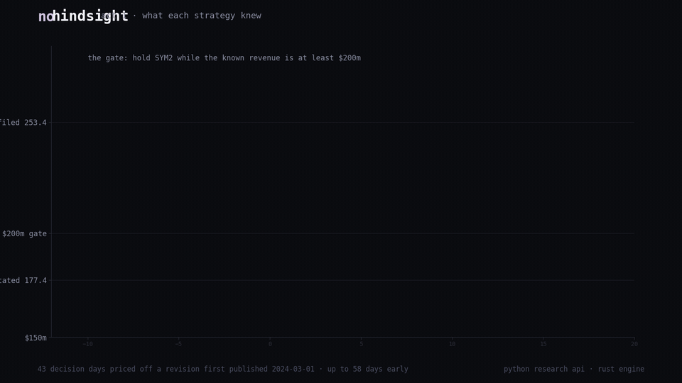
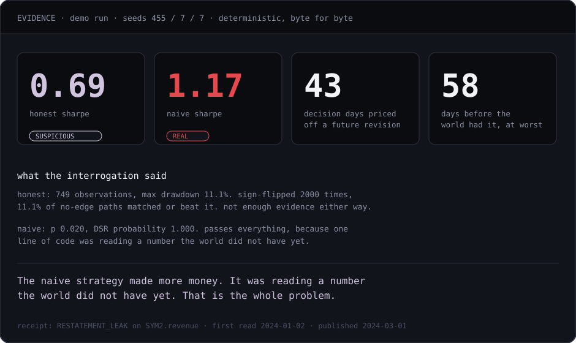
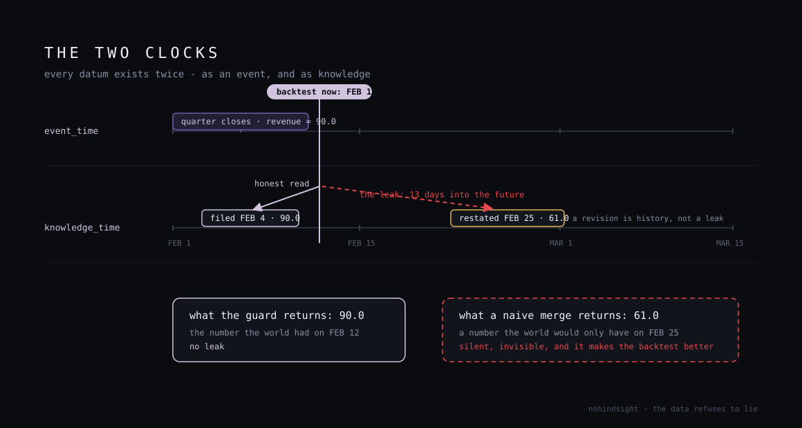
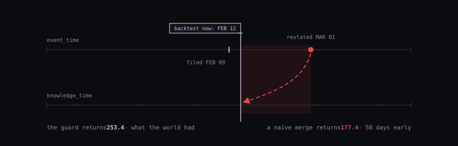
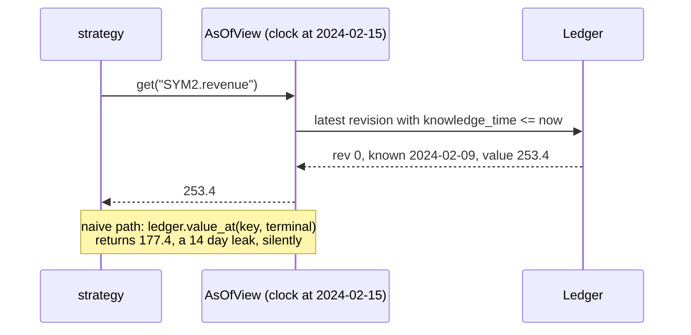
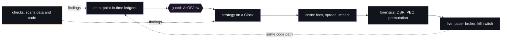
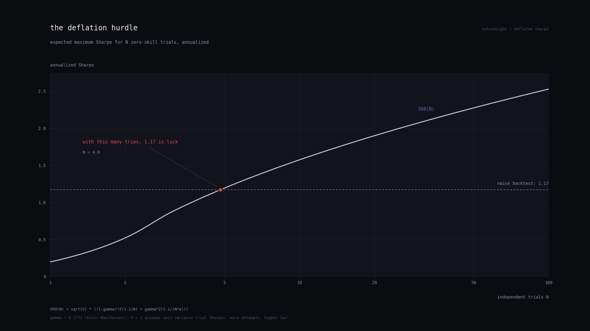

<p align="center">
  
</p>

[](https://github.com/RXVEN-1907/nohindsight/actions/workflows/ci.yml)
[](https://github.com/RXVEN-1907/nohindsight/actions/workflows/rust.yml)
[](LICENSE)
[](Cargo.toml)
[](pyproject.toml)
[](Cargo.toml)

> A quant toolkit built around one question: is your strategy real, or did it cheat by accident?

Not a backtester. The layer around one: data that records when it became
knowable, scanners for the standard cheats, costs priced from market
structure, statistics that discount luck, a risk layer for live use.
Python research API, Rust engine, both dependency-free.

---

## The demo, in 30 seconds

Two identical strategies run through the same engine, same broker, same
fees. They differ in one line: how they read a restated revenue figure.
The naive one applies today's number to every historical date, which is
what a casual pandas merge does silently.

<p align="center">
  
</p>

| | verdict | sharpe | permutation p |
|---|---|---|---|
| honest (guarded read) | SUSPICIOUS | 0.69 | 0.111 |
| naive (leaking read) | REAL | 1.17 | 0.020 |

Leak accounting: 43 decision days priced off a revision first published
2024-03-01, first read 2024-01-02, up to 58 days before the world had it.

<p align="center">
  
</p>

```bash
git clone https://github.com/RXVEN-1907/nohindsight && cd nohindsight
python -m nohindsight demo          # the research API
cargo run --release -- demo         # the engine, same story
```

---

## How the guard works

Every record carries two timestamps. `event_time` is when the thing
happened. `knowledge_time` is when an honest observer could have first
known it. A backtest on 2024-02-15 that reads the restated 177.4, first
knowable 2024-03-01, has leaked, and leaks always flatter the result.

<p align="center">
  
</p>

```python
from nohindsight import Clock, Ledger

ledger = Ledger("fundamentals")
ledger.append("SYM2.revenue", 253.4, "2023-12-31", "2024-02-09")  # first filing
ledger.append("SYM2.revenue", 177.4, "2023-12-31", "2024-03-01")  # restatement

view = ledger.view(Clock("2024-02-15"))
view.get("SYM2.revenue")   # 253.4: latest revision knowable on that date
```

<p align="center">
  
</p>



---

## The departments



| | | |
|---|---|---|
| **data** | append-only revisioned ledgers, universes with ghosts, EDGAR and ALFRED adapters | catches restatements applied early, survivorship |
| **checks** | OHLC integrity, gaps, stale bars, duplicates, crossed quotes, split detector, AST lint for future-reading code | catches dirty bars and time travel |
| **costs** | fees, spread, borrow, square-root impact `sigma * sqrt(qty / ADV)` | prices the flat-slippage fantasy |
| **forensics** | Probabilistic and Deflated Sharpe, PBO via CSCV, permutation tests | catches selection on luck |
| **live** | decimal-exact paper broker, deterministic fill emulator, latching kill switch | catches the first live disaster |

The demo plants five real defect classes: an unadjusted 4:1 split, a
nine-day gap, five stale closes, a duplicated timestamp, and the
restatement. `checks` catches four from the bars alone. The fifth is only
visible through the two-clock model, which is the point.

---

## Forensics

<p align="center">
  
</p>

```python
from nohindsight.forensics import audit

v = audit(returns, n_trials=40)   # count the configs you tried, honestly
v.level       # REAL | SUSPICIOUS | FANTASY
v.reasons     # sentences citing the actual numbers
```

The best of 40 trials is positive under no edge, so the benchmark is not
zero. The audit computes that hurdle, tests against it with skew and
kurtosis included, cross-validates the winner out-of-sample (PBO), and
compares against a sign-flipped null. REAL: DSR probability at 0.95 or
higher, p under 0.05, PBO under 0.2.

<p align="center">
  
</p>
<p align="center">
  <sub>the hurdle rises with every configuration you try. at the crimson dot, 1.17 stops meaning anything.</sub>
</p>

---

## The syllabus

`docs/MILESTONES.md`: five milestones from "find one wrong thing in a CSV"
to "fit the square-root law on real crypto tapes" to "watch fifty lucky
monkeys get deflated". Each is one concept interviewers ask about and one
demoable artifact.

## Limitations

- Fill simulation is bar-close plus latency drift; no queue-position
  modeling yet.
- PBO samples CSCV combinations above 512; seeds are documented.
- EDGAR and ALFRED adapters are offline-safe skeletons, tested on fixtures.
- The runtime leak probe cannot see fixed-timestamp peeks; the AST lint
  catches those. Neither substitutes for the guard.
- The ONNX export is structurally validated, not numerically compared
  against torch output yet.

## Status

v0.1.0. 162 Python tests, 94 Rust tests, zero dependencies in both languages.
Build spec: `docs/SPEC.md`. Design tokens: `docs/DESIGN.md`.

MIT. Built to learn in public.
