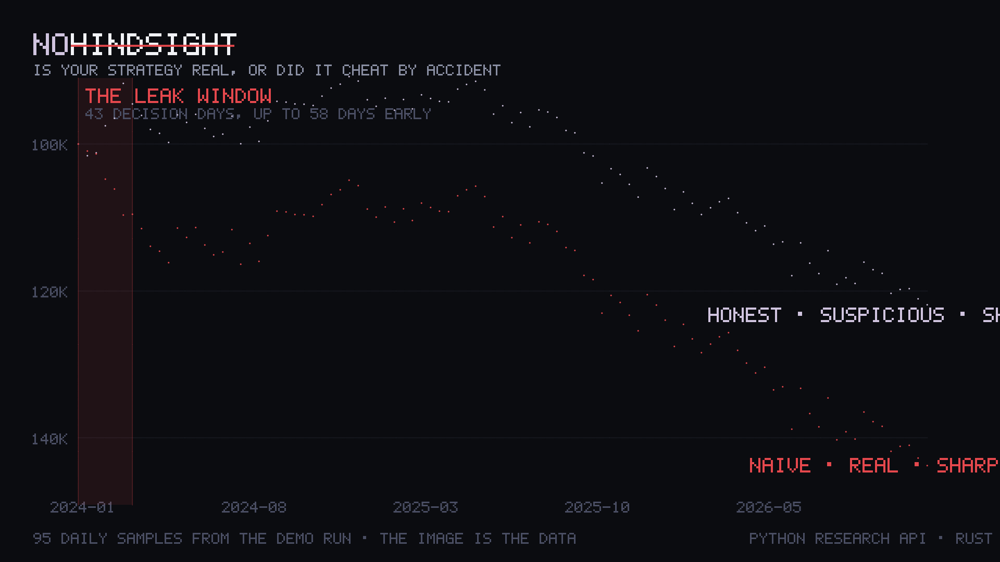
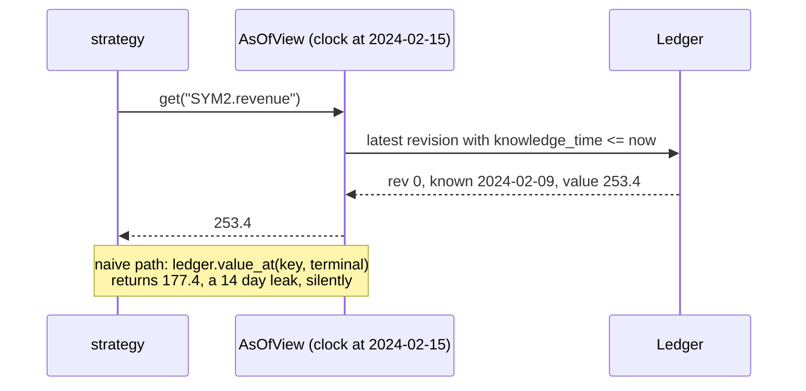
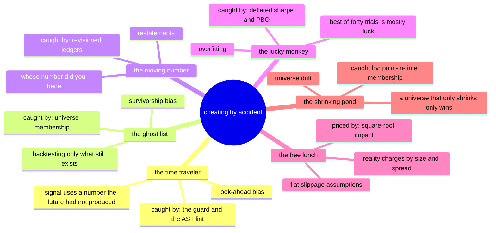
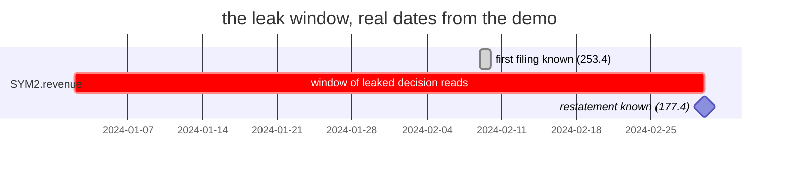
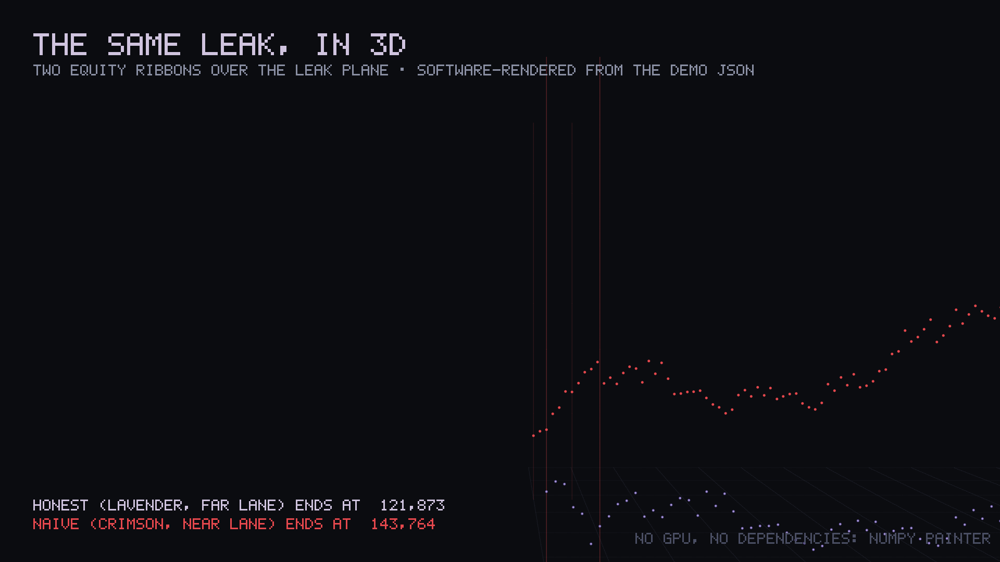
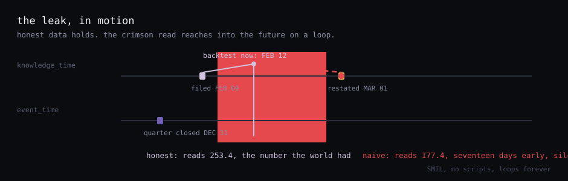
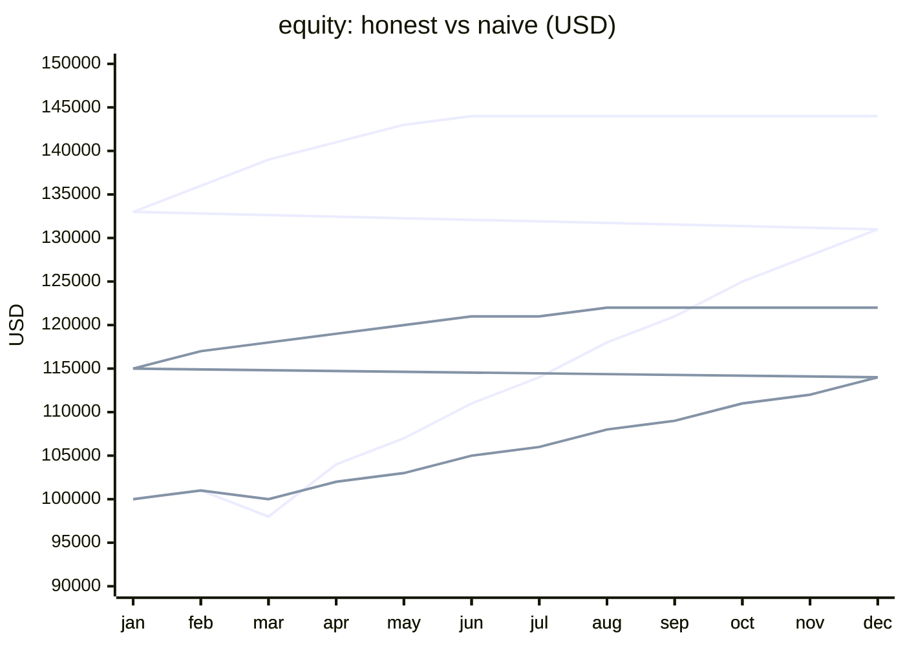

# **no**~~hindsight~~

> is your strategy real, or did it cheat by accident?

[](https://github.com/RXVEN-1907/nohindsight/actions/workflows/ci.yml)
[](https://github.com/RXVEN-1907/nohindsight/actions/workflows/rust.yml)
[](LICENSE)
[](Cargo.toml)
[](pyproject.toml)
[](Cargo.toml)

A quant toolkit built around one question. Not a backtester: the layer
around one. Data that records when it became knowable, scanners for the
standard cheats, costs priced from market structure, statistics that
discount luck, a risk layer for live use. Python research API, Rust
engine, both dependency-free. Every graphic on this page is generated from
one deterministic demo run, and every generator ships in this file.

<p align="center">
  
</p>

## The demo, animated

Two identical strategies run through the same engine, same broker, same
fees. They differ in one line: how they read a restated revenue figure.
The naive one applies today's number to every historical date, which is
what a casual pandas merge does silently. Watch where the extra return
comes from.

<p align="center">
  
</p>

| | verdict | sharpe | permutation p |
|---|---|---|---|
| honest (guarded read) | SUSPICIOUS | 0.69 | 0.111 |
| naive (leaking read) | REAL | 1.17 | 0.020 |

Leak accounting: 43 decision days priced off a revision first published
2024-03-01, first read 2024-01-02, up to 58 days before the world had it.
The naive strategy made more money because it read a number the world did
not have yet.

<p align="center">
  
</p>

Run it yourself: `python -m nohindsight demo` (research API) or
`cargo run --release -- demo` (the engine). Same story, both languages.

---

## The two clocks

Every record carries two timestamps: `event_time`, when the thing happened,
and `knowledge_time`, when an honest observer could have first known it. A
fundamental for Q4 2023 happened on 2023-12-31, became known 2024-02-09,
and was restated 2024-03-01. A backtest on 2024-02-15 must see 253.4.
Reading 177.4 there is the most common way a backtest lies, and it always
makes the result look better.

<p align="center">
  
</p>

```python
from nohindsight import Clock, Ledger

ledger = Ledger("fundamentals")
ledger.append("SYM2.revenue", 253.4, "2023-12-31", "2024-02-09")  # first filing
ledger.append("SYM2.revenue", 177.4, "2023-12-31", "2024-03-01")  # restatement

view = ledger.view(Clock("2024-02-15"))
view.get("SYM2.revenue")   # 253.4: latest revision knowable on that date
```



---

## The departments


| Department | What it does | What it catches |
|---|---|---|
| `data` | Append-only revisioned ledgers; universes with delisted ghosts; SEC EDGAR and ALFRED vintage adapters | restatements applied early, survivorship |
| `checks` | OHLC integrity, gaps, stale bars, duplicates, crossed quotes, a split detector, an AST lint for future-reading code | dirty bars, `shift(-1)` habits |
| `costs` | Fee schedules, spread, borrow, square-root impact: `bps = coeff * sigma * sqrt(qty / ADV)` | the flat-slippage fantasy |
| `forensics` | Probabilistic Sharpe, Deflated Sharpe (Bailey and Lopez de Prado, 2014), PBO via CSCV, permutation tests | selection on luck |
| `live` | Decimal-exact paper broker, deterministic fill emulator, a latching kill switch | the first live disaster |

The five planted defects are real defect classes: a 4:1 split left
unadjusted, a nine-day gap, five stale closes, a duplicated timestamp, and
the restatement. `checks` catches four from the bars alone. The fifth is
only visible through the two-clock model, which is the point.

<details>
<summary>the six species of accidental cheating, as a mindmap</summary>



</details>

---

## What forensics does to a Sharpe

<p align="center">
  
</p>

```python
from nohindsight.forensics import audit

v = audit(returns, n_trials=40)   # count the configs you tried, honestly
v.level       # REAL | SUSPICIOUS | FANTASY
v.reasons     # sentences citing the actual numbers
```

If you tried 40 configurations and kept the best, the expected best-of-40
Sharpe under no edge is already positive. The audit computes that hurdle,
runs a Probabilistic Sharpe test against it with skew and kurtosis
included, checks whether the in-sample winner survives out-of-sample
blocks (PBO), and compares against a sign-flipped null. REAL needs DSR
probability at 0.95 or higher, permutation p under 0.05, and PBO under 0.2
where a strategy set was provided.

<details>
<summary>the leak window as a gantt, real dates</summary>



</details>

---

## The leak, in 3D

<p align="center">
  
</p>

No GPU, no renderer dependency: a numpy painter with a pinhole camera
projects the two ribbons, the leak plane sits between the lanes, and the
painter's order does the depth. The source below is the complete renderer,
the same machinery that drew the hero image and every video frame.

<details>
<summary>Three.js source: the 3D ribbons page</summary>

````html
<!doctype html>
<html lang="en">
<head>
<meta charset="utf-8">
<meta name="viewport" content="width=device-width, initial-scale=1">
<title>two clocks, one edge</title>
<!--
  Data: gallery/data/leak_demo.json, regenerated by gallery/data/export_demo_data.py.
  The scene reads the inline copy below. Refresh it by hand if the demo data changes.
  Palette: docs/DESIGN.md. Lavender is the truth. Crimson is the leak.
  Classic global build of three.js, pinned to 0.160.0: the last release that
  shipped a UMD three.min.js. No OrbitControls, drag rotation is 20 lines
  of pointer math instead of a second CDN request.
-->
<style>
  :root {
    --canvas: #0B0C10;
    --panel: #12141C;
    --hairline: #2A2D3A;
    --text: #F2F3F7;
    --muted: #8A8FA3;
    --ghost: #4A4E63;
    --lavender: #D0C4DF;
    --lavender-deep: #705EB1;
    --crimson: #E5484D;
    --sulfur: #E6B455;
    --blue: #5B8DEF;
    --mono: ui-monospace, SFMono-Regular, Menlo, Consolas, "Liberation Mono", monospace;
  }
  * { box-sizing: border-box; }
  html, body { margin: 0; height: 100%; overflow: hidden; }
  body {
    background: var(--canvas);
    color: var(--text);
    font: 15px/1.5 system-ui, -apple-system, "Segoe UI", sans-serif;
  }
  #stage { position: fixed; inset: 0; cursor: grab; }
  #stage.grabbing { cursor: grabbing; }
  .hud {
    position: fixed;
    top: 26px;
    left: 30px;
    max-width: 460px;
    pointer-events: none;
  }
  .hud h1 { font-size: 19px; font-weight: 600; margin: 0 0 6px; }
  .hud .sub { color: var(--muted); font-size: 13px; margin: 0 0 14px; }
  .chips { display: flex; flex-direction: column; gap: 6px; }
  .chip {
    border: 1px solid var(--hairline);
    background: color-mix(in srgb, var(--panel) 88%, transparent);
    border-radius: 6px;
    padding: 6px 10px;
    font-family: var(--mono);
    font-size: 12px;
    color: var(--muted);
    width: fit-content;
  }
  .chip .lvl { font-weight: 700; }
  .chip.honest .lvl { color: var(--lavender); }
  .chip.naive .lvl { color: var(--crimson); }
  .chip.leak { color: var(--muted); }
  .chip.leak .lvl { color: var(--crimson); }
  .chip .num { color: var(--text); }
  .hint {
    margin-top: 14px;
    color: var(--ghost);
    font-family: var(--mono);
    font-size: 11.5px;
  }
  .nocdn { color: var(--muted); font-family: var(--mono); font-size: 13px; }
</style>
</head>
<body>
<div id="stage"></div>
<div class="hud">
  <h1>same strategy, one leak</h1>
  <p class="sub">The two equity paths pulled apart in z. Time runs left to right, equity runs up.
  The flat crimson patch on the floor is the leak window: the span where the naive path
  read a revision the world did not have yet.</p>
  <div class="chips" id="chips"></div>
  <p class="hint">drag to rotate. it drifts on its own.</p>
  <noscript><p class="nocdn">this page needs javascript. the 2d chart does not.</p></noscript>
</div>

<script src="https://cdnjs.cloudflare.com/ajax/libs/three.js/0.160.0/three.min.js"></script>
<script>
"use strict";

/* Inline copy of gallery/data/leak_demo.json.
   Regenerated by gallery/data/export_demo_data.py. Strict JSON except NaN,
   which is written as null here. */
const FALLBACK = {
  "meta": {
    "generator": "gallery/data/export_demo_data.py",
    "note": "regenerate with: python gallery/data/export_demo_data.py",
    "seeds": { "price": 455, "fundamentals": 7, "fills": 7 }
  },
  "honest": {
    "level": "SUSPICIOUS",
    "sharpe": 0.691,
    "dsr_prob": 1.0,
    "permutation_p": null,
    "max_drawdown": 0.1106,
    "reasons": [
      "Annualized Sharpe is 0.69 over 749 observations (t-stat 1.19, max drawdown 11.1%).",
      "With a single trial there is no selection effect to deflate: the probability this Sharpe is genuinely above zero is 1.000.",
      "Flipping every return's sign at random 2000 times, 11.1% of no-edge paths matched or beat your Sharpe (p = 0.111).",
      "Some tests passed and some did not: not enough evidence either way."
    ]
  },
  "naive": {
    "level": "REAL",
    "sharpe": 1.168,
    "dsr_prob": 1.0,
    "permutation_p": null,
    "max_drawdown": 0.1068,
    "reasons": [
      "Annualized Sharpe is 1.17 over 749 observations (t-stat 2.01, max drawdown 10.7%).",
      "With a single trial there is no selection effect to deflate: the probability this Sharpe is genuinely above zero is 1.000.",
      "Flipping every return's sign at random 2000 times, 2.0% of no-edge paths matched or beat your Sharpe (p = 0.020).",
      "Every forensic test passed: this looks like a real edge, not fitted noise."
    ]
  },
  "leak": {
    "code": "RESTATEMENT_LEAK",
    "severity": "2",
    "message": "naive read SYM2.revenue on 43 decision days from the terminal snapshot - a revision first published 2024-03-01, used up to 58 days before the world had it (first: 2024-01-02)",
    "detail": {
      "key": "SYM2.revenue",
      "leak_days": "43",
      "first_leak_day": "2024-01-02",
      "knowledge_time": "2024-03-01",
      "max_lag_days": "58"
    }
  },
  "split_caught": true,
  "curve": [
    { "date": "2024-01-02", "honest": 99996.51, "naive": 99996.5 },
    { "date": "2024-01-12", "honest": 101583.64, "naive": 100948.41 },
    { "date": "2024-01-24", "honest": 101191.77, "naive": 101344.67 },
    { "date": "2024-02-05", "honest": 97509.76, "naive": 104799.77 },
    { "date": "2024-02-15", "honest": 96496.36, "naive": 106144.11 },
    { "date": "2024-02-27", "honest": 91756.83, "naive": 109687.52 },
    { "date": "2024-03-08", "honest": 94552.2, "naive": 109581.62 },
    { "date": "2024-03-20", "honest": 96092.31, "naive": 111508.53 },
    { "date": "2024-04-01", "honest": 98007.16, "naive": 113904.27 },
    { "date": "2024-04-11", "honest": 98566.56, "naive": 114604.16 },
    { "date": "2024-04-23", "honest": 99798.44, "naive": 116145.42 },
    { "date": "2024-05-03", "honest": 96035.15, "naive": 111437.0 },
    { "date": "2024-05-15", "honest": 97047.82, "naive": 112704.0 },
    { "date": "2024-05-27", "honest": 95974.75, "naive": 111361.44 },
    { "date": "2024-06-06", "honest": 97876.56, "naive": 113740.87 },
    { "date": "2024-06-18", "honest": 98962.26, "naive": 115099.23 },
    { "date": "2024-06-28", "honest": 98646.09, "naive": 114703.66 },
    { "date": "2024-07-10", "honest": 96217.57, "naive": 111665.24 },
    { "date": "2024-07-22", "honest": 99965.9, "naive": 116354.93 },
    { "date": "2024-08-01", "honest": 97714.32, "naive": 113537.89 },
    { "date": "2024-08-13", "honest": 99658.29, "naive": 115970.07 },
    { "date": "2024-08-23", "honest": 96852.43, "naive": 112459.54 },
    { "date": "2024-09-04", "honest": 94189.42, "naive": 109127.73 },
    { "date": "2024-09-16", "honest": 94291.55, "naive": 109255.52 },
    { "date": "2024-09-26", "honest": 94555.69, "naive": 109585.99 },
    { "date": "2024-10-08", "honest": 94588.75, "naive": 109627.36 },
    { "date": "2024-10-18", "honest": 94776.73, "naive": 109862.54 },
    { "date": "2024-10-30", "honest": 93493.26, "naive": 108256.75 },
    { "date": "2024-11-11", "honest": 92377.9, "naive": 106861.27 },
    { "date": "2024-11-21", "honest": 91867.51, "naive": 106222.69 },
    { "date": "2024-12-03", "honest": 90835.67, "naive": 104931.72 },
    { "date": "2024-12-13", "honest": 91432.06, "naive": 105677.88 },
    { "date": "2024-12-25", "honest": 93983.79, "naive": 108870.46 },
    { "date": "2025-01-06", "honest": 94862.96, "naive": 109970.44 },
    { "date": "2025-01-16", "honest": 93753.33, "naive": 108582.13 },
    { "date": "2025-01-28", "honest": 95385.18, "naive": 110623.79 },
    { "date": "2025-02-07", "honest": 93934.76, "naive": 108809.13 },
    { "date": "2025-02-19", "honest": 95218.8, "naive": 110415.64 },
    { "date": "2025-03-03", "honest": 93318.21, "naive": 108037.73 },
    { "date": "2025-03-13", "honest": 93793.01, "naive": 108631.77 },
    { "date": "2025-03-25", "honest": 94188.79, "naive": 109126.95 },
    { "date": "2025-04-04", "honest": 94258.89, "naive": 109214.65 },
    { "date": "2025-04-16", "honest": 92538.93, "naive": 107062.74 },
    { "date": "2025-04-28", "honest": 91875.69, "naive": 106232.93 },
    { "date": "2025-05-08", "honest": 91478.67, "naive": 105736.2 },
    { "date": "2025-05-20", "honest": 92619.71, "naive": 107163.81 },
    { "date": "2025-05-30", "honest": 95922.44, "naive": 111295.99 },
    { "date": "2025-06-11", "honest": 94780.18, "naive": 109866.86 },
    { "date": "2025-06-23", "honest": 97081.2, "naive": 112745.76 },
    { "date": "2025-07-03", "honest": 95713.27, "naive": 111034.28 },
    { "date": "2025-07-15", "honest": 97648.81, "naive": 113455.92 },
    { "date": "2025-07-25", "honest": 95358.42, "naive": 110590.32 },
    { "date": "2025-08-06", "honest": 95635.66, "naive": 110937.19 },
    { "date": "2025-08-18", "honest": 96397.69, "naive": 111890.59 },
    { "date": "2025-08-28", "honest": 98167.39, "naive": 114104.74 },
    { "date": "2025-09-09", "honest": 98465.11, "naive": 114477.23 },
    { "date": "2025-09-19", "honest": 101197.47, "naive": 117895.79 },
    { "date": "2025-10-01", "honest": 101643.75, "naive": 118454.16 },
    { "date": "2025-10-13", "honest": 105303.65, "naive": 123033.2 },
    { "date": "2025-10-23", "honest": 103370.62, "naive": 120614.72 },
    { "date": "2025-11-04", "honest": 104148.79, "naive": 121588.32 },
    { "date": "2025-11-14", "honest": 105508.39, "naive": 123289.37 },
    { "date": "2025-11-26", "honest": 107213.66, "naive": 125422.91 },
    { "date": "2025-12-08", "honest": 103275.5, "naive": 120495.7 },
    { "date": "2025-12-18", "honest": 104411.85, "naive": 121917.44 },
    { "date": "2025-12-30", "honest": 106057.5, "naive": 123976.38 },
    { "date": "2026-01-09", "honest": 108918.29, "naive": 127555.63 },
    { "date": "2026-01-21", "honest": 106516.69, "naive": 124550.9 },
    { "date": "2026-02-02", "honest": 108088.91, "naive": 126517.96 },
    { "date": "2026-02-12", "honest": 109593.14, "naive": 128399.97 },
    { "date": "2026-02-24", "honest": 108670.0, "naive": 127244.99 },
    { "date": "2026-03-06", "honest": 107879.84, "naive": 126256.39 },
    { "date": "2026-03-18", "honest": 107421.08, "naive": 125682.41 },
    { "date": "2026-03-30", "honest": 109339.01, "naive": 128082.02 },
    { "date": "2026-04-09", "honest": 110726.74, "naive": 129818.26 },
    { "date": "2026-04-21", "honest": 111804.57, "naive": 131166.78 },
    { "date": "2026-05-01", "honest": 111175.81, "naive": 130380.11 },
    { "date": "2026-05-13", "honest": 113645.17, "naive": 133469.63 },
    { "date": "2026-05-25", "honest": 113317.65, "naive": 133059.86 },
    { "date": "2026-06-04", "honest": 117928.54, "naive": 138828.74 },
    { "date": "2026-06-16", "honest": 113462.9, "naive": 133241.59 },
    { "date": "2026-06-26", "honest": 116217.22, "naive": 136687.63 },
    { "date": "2026-07-08", "honest": 117651.77, "naive": 138482.45 },
    { "date": "2026-07-20", "honest": 114530.0, "naive": 134576.68 },
    { "date": "2026-07-30", "honest": 119079.22, "naive": 140268.4 },
    { "date": "2026-08-11", "honest": 118217.24, "naive": 139189.94 },
    { "date": "2026-08-21", "honest": 118996.87, "naive": 140165.37 },
    { "date": "2026-09-02", "honest": 116064.17, "naive": 136496.14 },
    { "date": "2026-09-14", "honest": 117105.75, "naive": 137799.31 },
    { "date": "2026-09-24", "honest": 117605.39, "naive": 138424.43 },
    { "date": "2026-10-06", "honest": 120340.23, "naive": 141846.09 },
    { "date": "2026-10-16", "honest": 119801.66, "naive": 141172.27 },
    { "date": "2026-10-28", "honest": 119676.84, "naive": 141016.1 },
    { "date": "2026-11-09", "honest": 121069.54, "naive": 142758.57 },
    { "date": "2026-11-16", "honest": 121873.93, "naive": 143764.97 }
  ]
};

const LAVENDER = 0xD0C4DF;
const CRIMSON = 0xE5484D;
const CANVAS = 0x0B0C10;
const HAIRLINE = 0x2A2D3A;
const GHOST = 0x4A4E63;
const MONO = 'ui-monospace, SFMono-Regular, Menlo, Consolas, "Liberation Mono", monospace';

const stage = document.getElementById("stage");

function renderChips(d) {
  const box = document.getElementById("chips");
  const last = d.curve[d.curve.length - 1];
  const det = d.leak.detail;
  const mk = (cls, parts) => {
    const chip = document.createElement("div");
    chip.className = "chip " + cls;
    for (const [c, text] of parts) {
      const span = document.createElement("span");
      if (c) span.className = c;
      span.textContent = text;
      chip.append(span);
    }
    box.append(chip);
  };
  const fmt = n => n.toLocaleString("en-US", { maximumFractionDigits: 0 });
  mk("honest", [
    [null, "honest (guarded) : "],
    ["lvl", d.honest.level],
    [null, " : "],
    ["num", `Sharpe ${d.honest.sharpe.toFixed(2)} : final ${fmt(last.honest)}`]
  ]);
  mk("naive", [
    [null, "naive (leaking) : "],
    ["lvl", d.naive.level],
    [null, " : "],
    ["num", `Sharpe ${d.naive.sharpe.toFixed(2)} : final ${fmt(last.naive)}`]
  ]);
  mk("leak", [
    ["lvl", d.leak.code],
    [null, ` : ${det.leak_days} decision days : up to ${det.max_lag_days} days early`]
  ]);
}

function label(text, cssColor, height) {
  // Text as a canvas texture on a sprite. No font loader, no extra request.
  const pad = 18, fs = 46;
  const c = document.createElement("canvas");
  let ctx = c.getContext("2d");
  ctx.font = `500 ${fs}px ${MONO}`;
  c.width = Math.ceil(ctx.measureText(text).width) + pad * 2;
  c.height = fs + pad * 2;
  ctx = c.getContext("2d");
  ctx.font = `500 ${fs}px ${MONO}`;
  ctx.fillStyle = cssColor;
  ctx.textBaseline = "middle";
  ctx.fillText(text, pad, c.height / 2);
  const tex = new THREE.CanvasTexture(c);
  tex.colorSpace = THREE.SRGBColorSpace;
  const sprite = new THREE.Sprite(new THREE.SpriteMaterial({
    map: tex,
    transparent: true,
    depthTest: false
  }));
  sprite.scale.set(height * c.width / c.height, height, 1);
  sprite.renderOrder = 10;
  return sprite;
}

function build() {
  const scene = new THREE.Scene();
  scene.background = new THREE.Color(CANVAS);
  scene.fog = new THREE.Fog(CANVAS, 55, 130);

  const camera = new THREE.PerspectiveCamera(42, window.innerWidth / window.innerHeight, 0.1, 300);
  camera.position.set(26, 15, 31);
  camera.lookAt(0, 7, 0);

  const renderer = new THREE.WebGLRenderer({ antialias: true });
  renderer.setPixelRatio(Math.min(window.devicePixelRatio || 1, 2));
  renderer.setSize(window.innerWidth, window.innerHeight);
  stage.append(renderer.domElement);

  const world = new THREE.Group();
  scene.add(world);

  const pts = FALLBACK.curve;
  const n = pts.length;

  // Scale the data into world units. x: sample index across 30 units.
  // y: equity range mapped onto 2..15. z: one lane per clock.
  const lo = Math.min(...pts.map(p => Math.min(p.honest, p.naive)));
  const hi = Math.max(...pts.map(p => Math.max(p.honest, p.naive)));
  const xs = i => -15 + 30 * i / (n - 1);
  const ys = v => 2 + 13 * (v - lo) / (hi - lo);
  const Z_HONEST = -3, Z_NAIVE = 3;

  // Ribbons instead of bare lines: GL linewidth is ignored by most drivers.
  function ribbon(z, color, key) {
    const w = 0.5;
    const pos = new Float32Array(n * 2 * 3);
    for (let i = 0; i < n; i++) {
      const x = xs(i), y = ys(pts[i][key]);
      pos.set([x, y + w / 2, z], i * 6);
      pos.set([x, y - w / 2, z], i * 6 + 3);
    }
    const idx = [];
    for (let i = 0; i < n - 1; i++) {
      const a = i * 2, b = i * 2 + 1, c = i * 2 + 2, e = i * 2 + 3;
      idx.push(a, b, c, b, e, c);
    }
    const geo = new THREE.BufferGeometry();
    geo.setAttribute("position", new THREE.BufferAttribute(pos, 3));
    geo.setIndex(idx);
    const mesh = new THREE.Mesh(geo, new THREE.MeshBasicMaterial({
      color, side: THREE.DoubleSide
    }));
    // A crisp line along the top edge, same color. Keeps the silhouette.
    const edgeGeo = new THREE.BufferGeometry().setFromPoints(
      pts.map((p, i) => new THREE.Vector3(xs(i), ys(p[key]) + w / 2, z))
    );
    const edge = new THREE.Line(edgeGeo, new THREE.LineBasicMaterial({ color }));
    return [mesh, edge];
  }

  world.add(...ribbon(Z_HONEST, LAVENDER, "honest"));
  world.add(...ribbon(Z_NAIVE, CRIMSON, "naive"));

  // Floor grid, hairline gray. Purely for depth.
  const grid = new THREE.GridHelper(46, 23, HAIRLINE, HAIRLINE);
  grid.material.transparent = true;
  grid.material.opacity = 0.5;
  world.add(grid);

  // The leak window as a flat translucent plane between the lanes.
  // from: first early read. to: publication. The publication date sits
  // between two samples, so interpolate its x instead of snapping.
  const det = FALLBACK.leak.detail;
  const tFrom = Date.parse(det.first_leak_day);
  const tTo = Date.parse(det.knowledge_time);
  let xFrom = xs(0);
  let xTo = xs(n - 1);
  for (let i = 0; i < n; i++) {
    const t = Date.parse(pts[i].date);
    if (t >= tTo) {
      const tPrev = Date.parse(pts[i - 1].date);
      const f = (tTo - tPrev) / (t - tPrev);
      xTo = xs(i - 1) + f * (xs(i) - xs(i - 1));
      break;
    }
  }
  const plane = new THREE.Mesh(
    new THREE.PlaneGeometry(xTo - xFrom, 8),
    new THREE.MeshBasicMaterial({
      color: CRIMSON,
      transparent: true,
      opacity: 0.12,
      side: THREE.DoubleSide,
      depthWrite: false
    })
  );
  plane.rotation.x = -Math.PI / 2;
  plane.position.set((xFrom + xTo) / 2, 0.04, 0);
  world.add(plane);

  // A border keeps the 12% opacity patch legible from every angle.
  const bw = (xTo - xFrom) / 2, bd = 4;
  const borderGeo = new THREE.BufferGeometry().setFromPoints([
    new THREE.Vector3(-bw, 0.05, -bd),
    new THREE.Vector3(bw, 0.05, -bd),
    new THREE.Vector3(bw, 0.05, bd),
    new THREE.Vector3(-bw, 0.05, bd),
    new THREE.Vector3(-bw, 0.05, -bd)
  ]);
  const border = new THREE.Line(borderGeo, new THREE.LineBasicMaterial({
    color: CRIMSON, transparent: true, opacity: 0.5
  }));
  border.position.set((xFrom + xTo) / 2, 0, 0);
  world.add(border);

  // Labels. Sprites face the camera no matter how the group is rotated.
  const lastIdx = n - 1;
  const honLbl = label("honest (guarded)", "#D0C4DF", 0.95);
  honLbl.position.set(xs(lastIdx) + 2.2, ys(pts[lastIdx].honest) - 1.6, Z_HONEST);
  world.add(honLbl);
  const naLbl = label("naive (leaking)", "#E5484D", 0.95);
  naLbl.position.set(xs(lastIdx) + 2.2, ys(pts[lastIdx].naive) + 1.6, Z_NAIVE);
  world.add(naLbl);
  const leakLbl = label(`${det.first_leak_day} to ${det.knowledge_time}`, "#E5484D", 0.7);
  leakLbl.position.set((xFrom + xTo) / 2, 1.5, 0);
  world.add(leakLbl);

  // Year marks on the front edge of the grid, ghost gray.
  for (let i = 1; i < n; i++) {
    const yr = pts[i].date.slice(0, 4);
    if (pts[i - 1].date.slice(0, 4) !== yr) {
      const tick = label(yr, "#4A4E63", 0.55);
      tick.position.set(xs(i), 0.35, 7.2);
      world.add(tick);
    }
  }

  // Manual drag rotation. Auto-drift pauses while dragging and after,
  // unless the viewer asked the OS for less motion.
  const reduceMotion = window.matchMedia("(prefers-reduced-motion: reduce)").matches;
  let dragging = false;
  let px = 0, py = 0;
  stage.addEventListener("pointerdown", e => {
    dragging = true;
    px = e.clientX;
    py = e.clientY;
    stage.classList.add("grabbing");
    stage.setPointerCapture(e.pointerId);
  });
  stage.addEventListener("pointermove", e => {
    if (!dragging) return;
    world.rotation.y += (e.clientX - px) * 0.005;
    world.rotation.x = Math.max(-0.35, Math.min(0.7, world.rotation.x + (e.clientY - py) * 0.003));
    px = e.clientX;
    py = e.clientY;
  });
  const drop = () => {
    dragging = false;
    stage.classList.remove("grabbing");
  };
  stage.addEventListener("pointerup", drop);
  stage.addEventListener("pointercancel", drop);

  window.addEventListener("resize", () => {
    camera.aspect = window.innerWidth / window.innerHeight;
    camera.updateProjectionMatrix();
    renderer.setSize(window.innerWidth, window.innerHeight);
  });

  renderer.setAnimationLoop(() => {
    if (!dragging && !reduceMotion) world.rotation.y += 0.0022;
    renderer.render(scene, camera);
  });
}

renderChips(FALLBACK);
if (typeof THREE === "undefined") {
  const note = document.createElement("p");
  note.className = "nocdn";
  note.textContent = "three.js failed to load from the CDN. The verdict chips are still accurate.";
  document.querySelector(".hud").append(note);
} else {
  build();
}
</script>
</body>
</html>
````

</details>

---

## The leak, in motion

This SVG animates right on this page: the crimson read marches toward the
future revision on a loop while the honest line holds. Pure SMIL, no
scripts, no GIF, a few kilobytes.

<p align="center">
  
</p>

<details>
<summary>CSS keyframes source: the pulse page</summary>

````html
<!doctype html>
<html lang="en">
<head>
<meta charset="utf-8">
<meta name="viewport" content="width=device-width, initial-scale=1">
<title>the leak, pulsing</title>
<!-- No javascript on this page. The march is stroke-dashoffset, the pulse
     is opacity, both plain CSS keyframes. Reduced motion gets a static
     dashed line. Numbers come from gallery/data/leak_demo.json,
     regenerated by gallery/data/export_demo_data.py.
     Palette: docs/DESIGN.md. Lavender is the truth. Crimson is the leak. -->
<style>
  :root {
    --canvas: #0B0C10;
    --panel: #12141C;
    --hairline: #2A2D3A;
    --text: #F2F3F7;
    --muted: #8A8FA3;
    --ghost: #4A4E63;
    --lavender: #D0C4DF;
    --lavender-deep: #705EB1;
    --crimson: #E5484D;
    --sulfur: #E6B455;
    --blue: #5B8DEF;
    --mono: ui-monospace, SFMono-Regular, Menlo, Consolas, "Liberation Mono", monospace;
  }
  * { box-sizing: border-box; }
  html, body { margin: 0; }
  body {
    min-height: 100vh;
    display: grid;
    place-items: center;
    background: var(--canvas);
    color: var(--text);
    font: 15px/1.5 system-ui, -apple-system, "Segoe UI", sans-serif;
    padding: 40px 0;
  }
  .sheet { width: min(880px, 92vw); }
  h1 { font-size: 20px; font-weight: 600; margin: 0 0 6px; }
  .sub { color: var(--muted); font-size: 13.5px; margin: 0 0 22px; }
  svg { width: 100%; height: auto; display: block; }
  svg text {
    font-family: var(--mono);
    font-size: 12px;
    fill: var(--muted);
  }
  svg .lbl-honest { fill: var(--lavender); font-size: 12.5px; }
  svg .lbl-naive { fill: var(--crimson); font-size: 12.5px; }
  svg .lbl-title { fill: var(--text); font-size: 13px; }
  svg .lbl-ghost { fill: var(--ghost); }
  .leakline {
    stroke-dasharray: 10 8;
    animation:
      march 2.4s linear infinite,
      breathe 2.4s ease-in-out infinite;
  }
  .beacon { animation: breathe 2.4s ease-in-out infinite; }
  /* -36 is two dash periods (10 + 8), so the loop is seamless.
     Negative offset marches the dashes forward, toward the revision. */
  @keyframes march {
    from { stroke-dashoffset: 0; }
    to   { stroke-dashoffset: -36; }
  }
  @keyframes breathe {
    0%, 100% { opacity: 0.45; }
    50%      { opacity: 1; }
  }
  @media (prefers-reduced-motion: reduce) {
    .leakline { animation: none; opacity: 0.85; }
    .beacon { animation: none; opacity: 1; }
  }
  .meta {
    margin-top: 26px;
    border-top: 1px solid var(--hairline);
    padding-top: 12px;
    font-family: var(--mono);
    font-size: 12px;
    color: var(--muted);
  }
  .meta .code { color: var(--crimson); }
</style>
</head>
<body>
<div class="sheet">
  <h1>the naive line borrows from the future</h1>
  <p class="sub">SYM2.revenue, revised 2024-03-01, read from the terminal snapshot starting
  2024-01-02. 43 decision days, 58 days early at most. The dashed span below never stops
  reaching for the revision. The honest span just stays where the facts are.</p>

  <svg viewBox="0 0 880 300" role="img"
       aria-label="Timeline: a steady lavender honest segment stops at the first read. A crimson dashed segment pulses from that point toward the revision published 2024-03-01.">
    <!-- calendar axis -->
    <line x1="40" y1="250" x2="840" y2="250" stroke="#2A2D3A" stroke-width="1"/>
    <text x="470" y="272" text-anchor="middle">2024-01-02</text>
    <text x="780" y="272" text-anchor="middle">2024-03-01</text>
    <text x="840" y="272" text-anchor="end" class="lbl-ghost">later</text>

    <!-- now: where the curves stop and the leak starts -->
    <line x1="470" y1="66" x2="470" y2="244" stroke="#4A4E63" stroke-width="1" stroke-dasharray="2 5"/>
    <text x="470" y="54" text-anchor="middle" class="lbl-ghost">now</text>

    <!-- honest curve: steady lavender, stops at now -->
    <text x="40" y="150" class="lbl-honest">honest (guarded)</text>
    <line x1="40" y1="170" x2="470" y2="170" stroke="#D0C4DF" stroke-width="2.5" stroke-linecap="round"/>
    <circle cx="470" cy="170" r="4" fill="#D0C4DF"/>

    <!-- naive curve: crimson, also stops at now -->
    <text x="40" y="100" class="lbl-naive">naive (leaking)</text>
    <line x1="40" y1="120" x2="470" y2="120" stroke="#E5484D" stroke-width="2.5" stroke-linecap="round"/>
    <circle cx="470" cy="120" r="4" fill="#E5484D"/>

    <!-- the leak: dashed crimson, marching from the naive curve to the
         revision the world has not published yet -->
    <path class="leakline" d="M 474 120 H 776" fill="none"
          stroke="#E5484D" stroke-width="2.5" stroke-linecap="round"/>
    <path class="beacon" d="M 780 111 l 9 9 l -9 9 l -9 -9 Z" fill="#E5484D"/>
    <text x="780" y="76" text-anchor="middle" class="lbl-title">revision published</text>
    <text x="780" y="94" text-anchor="middle">2024-03-01</text>
  </svg>

  <p class="meta"><span class="code">RESTATEMENT_LEAK</span> : severity 2 : 43 decision days : first 2024-01-02 : published 2024-03-01 : max lag 58 days</p>
</div>
</body>
</html>
````

</details>

<details>
<summary>Manim source: the two clocks scene</summary>

````py
"""Two clocks, one leak.

A short Manim CE scene. Two horizontal number lines: event_time, what
happened, and knowledge_time, what the world knew and when. A playhead
walks event_time. A revision bar appears on knowledge_time only after the
playhead has passed, because the revision is future knowledge. A dashed
crimson arrow connects the now to that future bar. That distance is the
leak.

Targets Manim CE 0.18+. Render:
    manim -qm manim_two_clocks.py TwoClocks

Palette per docs/DESIGN.md. Lavender is the truth. Crimson is the leak,
used only where the leak is.
"""

from manim import (
    DOWN,
    LEFT,
    RIGHT,
    UP,
    Create,
    DashedLine,
    FadeIn,
    FadeOut,
    Flash,
    Line,
    Rectangle,
    Scene,
    Text,
    VGroup,
    Write,
)

CANVAS = "#0B0C10"
HAIRLINE = "#2A2D3A"
TEXT = "#F2F3F7"
MUTED = "#8A8FA3"
LAVENDER = "#D0C4DF"
CRIMSON = "#E5484D"

# event_time tick positions on the line. Same calendar on both clocks:
# a given date sits at the same x on either line.
X_FIRST_READ = -4.0   # 2024-01-02, first decision that read the revision early
X_PUBLISHED = -1.2    # 2024-03-01, the day the revision went public
X_LAST = 4.8          # 2026-11-16, last day of the demo curve
Y_EVENT = 1.3
Y_KNOWLEDGE = -1.3


class TwoClocks(Scene):
    def construct(self):
        self.camera.background_color = CANVAS

        clocks = self.build_clocks()
        self.play(
            FadeIn(clocks[0], shift=DOWN * 0.3),
            FadeIn(clocks[1], shift=UP * 0.3),
            run_time=1.2,
        )
        self.wait(0.6)

        # The playhead walks event_time. It passes the first-read tick,
        # then stops mid-window. 43 decision days live in this span.
        ph = self.build_playhead(X_FIRST_READ)
        self.play(FadeIn(ph), run_time=0.5)
        self.wait(0.4)
        self.play(self.shift_playhead(ph, -2.6), run_time=1.6)
        self.wait(0.5)

        # The bar lands after the playhead has passed. Order matters:
        # the read happened early, the knowledge shows up late.
        bar = Rectangle(
            width=0.22,
            height=0.9,
            stroke_color=CRIMSON,
            stroke_width=1.5,
            fill_color=CRIMSON,
            fill_opacity=1.0,
        ).move_to([X_PUBLISHED, Y_KNOWLEDGE, 0])
        self.play(
            Create(bar),
            Flash(bar, color=CRIMSON, line_length=0.3, flash_radius=0.45),
            run_time=0.9,
        )
        note = Text("SYM2.revenue, revised", font_size=21, color=MUTED)
        note.next_to(bar, RIGHT, buff=0.3)
        self.play(FadeIn(note), run_time=0.5)

        # The span on event_time that the naive backtest spent early-reading.
        window = Line(
            [X_FIRST_READ, Y_EVENT - 0.14, 0],
            [X_PUBLISHED, Y_EVENT - 0.14, 0],
            stroke_color=CRIMSON,
            stroke_width=5,
            stroke_opacity=0.5,
        )
        self.play(Create(window), run_time=0.6)

        # Dashed, crimson: the read reaches from now into the future.
        # Solid lines are facts. Dashed is the theft.
        start = [-2.6, Y_EVENT - 0.08, 0]
        end = [X_PUBLISHED + 0.15, Y_KNOWLEDGE + 0.5, 0]
        reach = (
            DashedLine(start, end, color=CRIMSON, dash_length=0.14)
            .add_tip(tip_length=0.18, tip_width=0.18)
        )
        self.play(Create(reach), run_time=1.2)

        leak = Text("the leak", font_size=32, color=CRIMSON)
        mid = [(start[0] + end[0]) / 2, (start[1] + end[1]) / 2, 0]
        leak.next_to(mid, RIGHT, buff=0.45)
        self.play(Write(leak), run_time=0.9)
        self.wait(1.4)

        # Clear the floor. The card carries no verdict, just the name.
        self.play(*[FadeOut(m) for m in self.mobjects], run_time=0.9)
        brand = Text("nohindsight", font_size=68, color=LAVENDER)
        rule = Line(LEFT * 2.6, RIGHT * 2.6, color=LAVENDER, stroke_width=1.5)
        rule.next_to(brand, DOWN, buff=0.32)
        self.play(Write(brand), run_time=1.4)
        self.play(Create(rule), run_time=0.6)
        self.wait(2.0)

    def build_clocks(self):
        # Same calendar, two clocks. event_time above, knowledge_time below,
        # so the arrow from now down to the future bar reads as a reach.
        def clock_line(y, name, ticks):
            line = Line(
                [-6, y, 0],
                [6, y, 0],
                stroke_color=HAIRLINE,
                stroke_width=2,
            )
            label = Text(name, font_size=26, color=MUTED)
            label.next_to(line.get_start(), UP if y > 0 else DOWN, buff=0.28)
            label.align_to(line, LEFT)
            parts = [line, label]
            for x, tick_label in ticks:
                tick = Line(
                    [x, y - 0.1, 0],
                    [x, y + 0.1, 0],
                    stroke_color=MUTED,
                    stroke_width=1.5,
                )
                parts.append(tick)
                text = Text(tick_label, font_size=19, color=MUTED)
                text.next_to(tick, DOWN if y > 0 else UP, buff=0.16)
                parts.append(text)
            return VGroup(*parts)

        event = clock_line(
            Y_EVENT,
            "event_time",
            [(X_FIRST_READ, "2024-01-02"), (X_PUBLISHED, "2024-03-01"), (X_LAST, "2026-11-16")],
        )
        knowledge = clock_line(
            Y_KNOWLEDGE,
            "knowledge_time",
            [(X_PUBLISHED, "2024-03-01")],
        )
        return [event, knowledge]

    def build_playhead(self, x):
        # A small downward pointer riding event_time, with its label above.
        arrow = Line(
            [x, Y_EVENT + 0.85, 0],
            [x, Y_EVENT + 0.16, 0],
            stroke_color=TEXT,
            stroke_width=3.5,
        ).add_tip(tip_length=0.16, tip_width=0.16)
        text = Text("now", font_size=24, color=TEXT)
        text.next_to(arrow, UP, buff=0.14)
        return VGroup(arrow, text)

    def shift_playhead(self, ph, x):
        # move_to keeps the vertical position fixed, only x changes.
        return ph.animate.move_to([x, ph.get_center()[1], 0])
````

</details>

<details>
<summary>FFmpeg: mux the frames with the sonified audio</summary>

````sh
#!/usr/bin/env bash
# Splice the nohindsight leak story into video. Three commands, each one
# commented with what it does and why those flags.
#
# Inputs:
#   frames: gallery/media/frames/frame_00000.png and up, rendered by
#           gallery/media/manim_two_clocks.py (the media slice owns that).
#   audio:  gallery/audio/leak_chorus.wav, rendered by gallery/audio/sonify.py.
#
# Outputs land next to this script by default. Override with env vars:
#   FRAMES_DIR, FRAME_PATTERN, AUDIO, OUT_DIR, FPS.
# Default mode prints a plan and the tool versions. RUN=1 executes.
# Nothing here muxes files that do not exist.

set -u

SCRIPT_DIR="$(cd "$(dirname "${BASH_SOURCE[0]}")" && pwd)"
FRAMES_DIR="${FRAMES_DIR:-$SCRIPT_DIR/../media/frames}"
FRAME_PATTERN="${FRAME_PATTERN:-frame_%05d.png}"
AUDIO="${AUDIO:-$SCRIPT_DIR/leak_chorus.wav}"
OUT_DIR="${OUT_DIR:-$SCRIPT_DIR}"
FPS="${FPS:-30}"
RUN="${RUN:-0}"

echo "ffmpeg:  $(ffmpeg -version 2>/dev/null | head -1)"
if command -v ffprobe >/dev/null 2>&1; then
  echo "ffprobe: $(command -v ffprobe)"
else
  echo "ffprobe: missing"
fi
echo "frames:  $FRAMES_DIR ($FRAME_PATTERN)"
echo "audio:   $AUDIO"
echo "out:     $OUT_DIR"
echo "mode:    $([ "$RUN" = "1" ] && echo run || echo plan)"

frames_ok=1
audio_ok=1
muxed_ok=1
[ -d "$FRAMES_DIR" ] || { frames_ok=0; }
[ -f "$AUDIO" ] || { audio_ok=0; }
[ -f "$OUT_DIR/nohindsight_leak.mp4" ] || { muxed_ok=0; }

# Measure the audio once. The fade-out needs a start time, which is the
# duration minus 2 s. awk does the arithmetic, no python dependency.
fade_out_start=""
if [ "$audio_ok" = "1" ]; then
  dur="$(ffprobe -v error -show_entries format=duration -of default=noprint_wrappers=1:nokey=1 "$AUDIO")"
  fade_out_start="$(awk -v d="$dur" 'BEGIN { printf "%.3f", d - 2.0 }')"
fi

# do_step LABEL GUARD CMD...
#   GUARD "ok" runs or plans the command. Any other text is a skip reason.
do_step() {
  local label="$1"; shift
  local guard="$1"; shift
  if [ "$guard" = "ok" ]; then
    if [ "$RUN" = "1" ]; then
      echo "run  [$label]"
      "$@"
    else
      printf 'plan [%s]\n  ' "$label"
      printf '%q ' "$@"
      printf '\n'
    fi
  else
    echo "skip [$label] $guard"
  fi
}

# (1) Mux the manim frames with the chorus into nohindsight_leak.mp4.
# The image pattern feeds ffmpeg's image2 demuxer.
#   -framerate $FPS : must match the rate manim rendered at. A mismatch
#                     silently stretches or compresses the timeline.
#   -c:v libx264    : h264, the one codec every player agrees on.
#   -pix_fmt yuv420p: 4:2:0 chroma. Fancier formats still break players.
#   -crf 18         : visually transparent without huge files.
#   -c:a aac 192k   : mp4 audio. A tone track needs nothing more.
#   -shortest       : end at the shorter stream, so the video does not
#                     outlive the audio into frozen frames or silence.
do_step "mux" "$([ "$frames_ok" = "1" ] && [ "$audio_ok" = "1" ] && echo ok || echo "missing frames or audio")" \
  ffmpeg -y -framerate "$FPS" -i "$FRAMES_DIR/$FRAME_PATTERN" -i "$AUDIO" \
    -c:v libx264 -preset medium -crf 18 -pix_fmt yuv420p \
    -c:a aac -b:a 192k -shortest \
    "$OUT_DIR/nohindsight_leak.mp4"

# (2) Same mux, with the audio faded. Hard-cutting a tone track clicks; the
# two afade filters fix that.
#   afade=t=in:st=0:d=2        : ramp from silence over the first 2 s.
#   afade=t=out:st=$start:d=2  : ramp to silence over the last 2 s. The
#                                start is duration minus 2, measured by
#                                ffprobe above. The fade touches audio
#                                only, the video stays full strength.
# The .wav output of sonify.py is about 25 s, so the fade-out starts near
# t=23 s. The beat section sits at the head and survives the fade-in.
do_step "fade-mux" "$([ "$frames_ok" = "1" ] && [ "$audio_ok" = "1" ] && echo ok || echo "missing frames or audio")" \
  ffmpeg -y -framerate "$FPS" -i "$FRAMES_DIR/$FRAME_PATTERN" -i "$AUDIO" \
    -c:v libx264 -preset medium -crf 18 -pix_fmt yuv420p \
    -af "afade=t=in:st=0:d=2,afade=t=out:st=${fade_out_start:-23.0}:d=2" \
    -c:a aac -b:a 192k -shortest \
    "$OUT_DIR/nohindsight_leak_faded.mp4"

# (3) One-liner: 15 s preview at 720p for social cards, cut from the
# finished mux.
#   -ss 0 before -i : seek on the input, fast, no decode of skipped time.
#   -t 15           : cap the clip at 15 s.
#   scale=-2:720    : height 720, width auto, and -2 forces the width even,
#                     which h264 requires.
#   crf 23, fast    : a preview can be a little cheaper than the master.
do_step "preview" "$([ "$muxed_ok" = "1" ] && echo ok || echo "run the mux step first")" \
  ffmpeg -y -ss 0 -t 15 -i "$OUT_DIR/nohindsight_leak.mp4" \
    -vf "scale=-2:720" -c:v libx264 -crf 23 -preset fast \
    -c:a aac -b:a 128k \
    "$OUT_DIR/leak_preview_720p.mp4"
````

</details>

---

## Sound

Equity maps to pitch over two octaves. During the leak window the naive
voice is pinned to the honest contour with a detune ramping to 75 cents.
Two tones at f and f plus d produce amplitude modulation at rate d, so the
dishonest path beats against the honest one until the restatement date,
where it snaps free. The mp4 above carries this soundtrack.

<details>
<summary>sonification source: stdlib WAV writer</summary>

````py
#!/usr/bin/env python3
"""Sonify the nohindsight restatement leak.

Reads gallery/data/leak_demo.json and renders the demo's two equity curves
as 16-bit mono WAV, 22050 Hz. Stdlib only. Deterministic. Three files:

  honest.wav       one tone tracking the honest curve. The baseline.
  naive.wav        the same pitch mapping on the naive curve: the path that
                   read restated revenue from the terminal snapshot.
  leak_chorus.wav  both tones mixed. During the leak window the naive tone
                   is pinned just above the honest one and drifts sharp.
                   Two sines at f and f + d produce amplitude modulation at
                   rate d. That beat is the point: the naive path sounds
                   sweet, then the wobble says something was off.

Pitch mapping: log2(equity / 100000) scaled linearly into 110 to 440 Hz,
A2 to A4, two octaves. Log first, then pitch: ears hear ratios, so a
strategy that doubles its equity should rise by octaves, not by a fixed
number of hertz.

Beat math, stated once: sin(2*pi*f*t) + sin(2*pi*(f+d)*t) equals
2*sin(2*pi*(f+d/2)*t)*cos(pi*d*t). The envelope repeats at rate d. The
detune here ramps from 0 to 75 cents across the leak window. The honest
tone sits near 113 Hz at the window edge, so d climbs from 0 to about
5.0 Hz: five wobbles a second, unmistakable. Harmonics of each tone beat
at integer multiples of d, which thickens the roughness.

The window is 2024-01-02 to 2024-03-01, the first six curve points, so the
beat section is the first 1.3 seconds of the chorus. At knowledge_time the
naive tone drops the pin and jumps to its natural pitch, several semitones
up: the fake edge, audible for the rest of the track. The two voices then
wander together and never reconcile. That is the data.

Usage: python gallery/audio/sonify.py [--out DIR]
"""

import argparse
import json
import math
import struct
import wave
from datetime import date
from pathlib import Path

SCRIPT_DIR = Path(__file__).resolve().parent
DATA_PATH = SCRIPT_DIR.parent / "data" / "leak_demo.json"

SAMPLE_RATE = 22050
TOTAL_SECONDS = 25.0
TARGET_PEAK = 0.80       # headroom under the 0.9 clipping line
PITCH_LOW_HZ = 110.0     # A2
PITCH_HIGH_HZ = 440.0    # A4. 110 to 440 Hz, two octaves.
ATTACK_SECONDS = 0.008   # short linear fade-in per segment: no clicks
RELEASE_SECONDS = 0.008  # short linear fade-out per segment: no clicks
HARMONICS = ((1, 1.0), (2, 0.20), (3, 0.10))  # sine with a little warmth
DETUNE_CENTS = 75.0      # how far the naive tone drifts sharp, at most


def load_curve():
    with open(DATA_PATH, "r") as f:
        data = json.load(f)
    points = data["curve"]
    detail = data["leak"]["detail"]
    dates = [date.fromisoformat(p["date"]) for p in points]
    honest = [float(p["honest"]) for p in points]
    naive = [float(p["naive"]) for p in points]
    window_lo = date.fromisoformat(detail["first_leak_day"])
    window_hi = date.fromisoformat(detail["knowledge_time"])
    return dates, honest, naive, window_lo, window_hi


def pitch_freqs(equities, lo, hi):
    # Map log-equity linearly onto log-frequency across the shared range.
    out = []
    for eq in equities:
        le = math.log2(eq / 100000.0)
        t = (le - lo) / (hi - lo)
        out.append(PITCH_LOW_HZ * 2.0 ** ((math.log2(PITCH_HIGH_HZ / PITCH_LOW_HZ)) * t))
    return out


def render(freqs, seg_samples, env):
    """One segment per point, gliding between pitches, phase continuous.

    Frequency is integrated into a running phase, so a moving pitch never
    discontinues and never clicks on its own. The linear attack and release
    per segment handle the boundaries.
    """
    n = len(freqs)
    total = seg_samples * n
    out = [0.0] * total
    two_pi_over_sr = 2.0 * math.pi / SAMPLE_RATE
    sin = math.sin
    phase = 0.0
    for seg in range(n):
        f0 = freqs[seg]
        f1 = freqs[seg + 1] if seg + 1 < n else freqs[seg]
        base = seg * seg_samples
        for j in range(seg_samples):
            f = f0 + (f1 - f0) * (j / seg_samples)
            phase += two_pi_over_sr * f
            s = 0.0
            for k, amp in HARMONICS:
                s += amp * sin(k * phase)
            out[base + j] = s * env[j]
    return out


def make_env(seg_samples):
    attack = max(1, int(ATTACK_SECONDS * SAMPLE_RATE))
    release = max(1, int(RELEASE_SECONDS * SAMPLE_RATE))
    env = [1.0] * seg_samples
    for i in range(min(attack, seg_samples)):
        env[i] = i / attack
    for i in range(min(release, seg_samples)):
        env[seg_samples - 1 - i] = i / release
    return env


def normalize(samples):
    peak = max(abs(s) for s in samples)
    if peak == 0.0:
        return list(samples)
    scale = TARGET_PEAK / peak
    return [s * scale for s in samples]


def write_wav(path, samples):
    ints = []
    for s in samples:
        v = max(-1.0, min(1.0, s))
        ints.append(int(v * 32767.0))
    w = wave.open(str(path), "wb")
    w.setnchannels(1)
    w.setsampwidth(2)
    w.setframerate(SAMPLE_RATE)
    w.writeframes(struct.pack("<%dh" % len(ints), *ints))
    w.close()


def report(path):
    # Open the finished file back up with the wave module and state facts.
    with wave.open(str(path), "rb") as w:
        frames = w.getnframes()
        sr = w.getframerate()
        raw = w.readframes(frames)
    ints = struct.unpack("<%dh" % frames, raw)
    peak = max(abs(i) for i in ints) / 32767.0
    print("wrote %s: %d bytes, %d frames, %.3f s, peak %.3f"
          % (path.name, path.stat().st_size, frames, frames / sr, peak))


def main():
    ap = argparse.ArgumentParser(description="Render the leak demo as audio.")
    ap.add_argument("--out", default=str(SCRIPT_DIR),
                    help="output directory (default: gallery/audio)")
    args = ap.parse_args()
    out = Path(args.out)
    out.mkdir(parents=True, exist_ok=True)

    dates, honest_eq, naive_eq, window_lo, window_hi = load_curve()
    print("read %s: %d points, %s to %s"
          % (DATA_PATH.relative_to(SCRIPT_DIR.parent.parent), len(dates),
             dates[0], dates[-1]))

    logs = [math.log2(v / 100000.0) for v in honest_eq + naive_eq]
    lo, hi = min(logs), max(logs)
    f_honest = pitch_freqs(honest_eq, lo, hi)
    f_naive = pitch_freqs(naive_eq, lo, hi)

    # Leak window: the naive tone hides behind the honest contour, one
    # fixed detune above it, ramping in. The real naive curve rose during
    # the window; the pin is deliberate. It makes the beat the whole show
    # and leaves the jump to knowledge_time as the reveal.
    window_idx = [i for i, d in enumerate(dates) if window_lo <= d <= window_hi]
    f_naive_pinned = list(f_naive)
    for pos, i in enumerate(window_idx):
        ramp = pos / max(1, len(window_idx) - 1)
        f_naive_pinned[i] = f_honest[i] * 2.0 ** (ramp * DETUNE_CENTS / 1200.0)

    seg_samples = int(TOTAL_SECONDS * SAMPLE_RATE) // len(dates)
    env = make_env(seg_samples)

    honest_track = normalize(render(f_honest, seg_samples, env))
    naive_track = normalize(render(f_naive, seg_samples, env))
    pinned_track = normalize(render(f_naive_pinned, seg_samples, env))
    # Equal weights. Neither voice owns the room.
    chorus = normalize([0.5 * a + 0.5 * b
                        for a, b in zip(honest_track, pinned_track)])

    write_wav(out / "honest.wav", honest_track)
    write_wav(out / "naive.wav", naive_track)
    write_wav(out / "leak_chorus.wav", chorus)
    print()
    report(out / "honest.wav")
    report(out / "naive.wav")
    report(out / "leak_chorus.wav")
    print()
    print("leak window: %s to %s, %d of %d points pinned"
          % (window_lo, window_hi, len(window_idx), len(dates)))
    if window_idx:
        last = window_idx[-1]
        d_hz = f_honest[last] * (2.0 ** (DETUNE_CENTS / 1200.0) - 1.0)
        print("detune: 0 to %d cents across the window. Beat rate d ends at "
              "%.1f Hz on a %.1f Hz tone." % (DETUNE_CENTS, d_hz, f_honest[last]))
        reveal = last * seg_samples / SAMPLE_RATE
        print("reveal: t=%.2f s, the naive tone drops the pin and jumps to "
              "its own pitch (%.0f to %.0f Hz)."
              % (reveal, f_naive_pinned[last], f_naive[last + 1]))
    print("done: 3 files in %s" % out)


if __name__ == "__main__":
    main()
````

</details>

<details>
<summary>MIDI source: a hand-rolled Standard MIDI File</summary>

````py
#!/usr/bin/env python3
"""Render the nohindsight leak demo as a Standard MIDI File.

Writes leak_score.mid next to this script. No mido: the file is written by
hand, and the layout below doubles as a lesson in the format.

Byte layout
-----------
The file is two chunks, back to back.

  MThd  4D 54 68 64    chunk tag, the ASCII string "MThd"
        00 00 00 06    header chunk length, always 6
        00 00          format 0: one track carries everything
        00 01          one track
        01 E0          division: 480 ticks per quarter note

  MTrk  4D 54 72 6B    chunk tag, the ASCII string "MTrk"
        xx xx xx xx    track length in bytes, patched in after serialization
        ...events...   each event is a delta time, then event bytes

Events used here:

  FF 51 03 07 A1 20   tempo meta: 500000 microseconds per quarter note,
                      which is 120 BPM. An eighth note is 240 ticks.
  Cn PP               program change on channel n. Channel 0 gets program
                      48, string ensemble: the honest lane hums. Channel 1
                      gets program 80, square lead: the naive lane talks
                      over it.
  9n KK VV            note on: channel n, key KK (60 is middle C),
                      velocity VV.
  8n KK VV            note off, same fields, velocity 0.
  FF 2F 00            end of track. Last event, always.

Delta times are variable-length quantities: 7 data bits per byte, high bit
set on every byte except the last, most significant group first. The grid
spacing is 240 ticks, which does not fit in 7 bits, so slot deltas are the
two bytes 81 70. Delta 0 is a single 00 byte and chains events at one tick.

Score layout
------------
The curve is quantized to one 1/8th-note slot per curve point, 95 slots,
23.75 seconds. Pitch is log2(equity / 100000) scaled into MIDI 45 to 69,
A2 to A4, 110 to 440 Hz: the same range sonify.py sings. When the naive
equity diverges from the honest equity by more than 5 percent, the naive
channel doubles its note one semitone up. A minor second. The interval that
sounds wrong on purpose, once per leaked decision.

Usage:
  python gallery/audio/midi_map.py           write leak_score.mid, then verify
  python gallery/audio/midi_map.py --verify  parse the existing file back
"""

import argparse
import json
import math
import struct
from pathlib import Path

SCRIPT_DIR = Path(__file__).resolve().parent
DATA_PATH = SCRIPT_DIR.parent / "data" / "leak_demo.json"
MIDI_PATH = SCRIPT_DIR / "leak_score.mid"

TICKS_PER_QUARTER = 480
BPM = 120.0
MICROSECONDS_PER_QUARTER = int(60_000_000 / BPM)  # 500000
SLOT_TICKS = TICKS_PER_QUARTER // 2               # eighth note: 240 ticks

NOTE_LOW = 45   # A2, 110 Hz
NOTE_HIGH = 69  # A4, 440 Hz, same range as the WAVs

HONEST_CHANNEL = 0
NAIVE_CHANNEL = 1
HONEST_PROGRAM = 48   # string ensemble
NAIVE_PROGRAM = 80    # square lead
HONEST_VELOCITY = 72
NAIVE_VELOCITY = 84
DISSONANT_VELOCITY = 76

DIVERGENCE_THRESHOLD = 0.05  # naive more than 5 percent off honest


def vlq(n):
    # Variable-length quantity: 7 bits per byte, high bit on all but last.
    out = [n & 0x7F]
    n >>= 7
    while n:
        out.append((n & 0x7F) | 0x80)
        n >>= 7
    return bytes(reversed(out))


def make_note_fn(curve):
    eqs = [float(p["honest"]) for p in curve] + [float(p["naive"]) for p in curve]
    logs = [math.log2(v / 100000.0) for v in eqs]
    lo, hi = min(logs), max(logs)

    def note(equity):
        t = (math.log2(equity / 100000.0) - lo) / (hi - lo)
        return max(NOTE_LOW, min(NOTE_HIGH, NOTE_LOW + round((NOTE_HIGH - NOTE_LOW) * t)))

    return note


def serialize(events):
    # events: (tick, order, payload). Note-offs sort before note-ons at the
    # same tick, so a slot ends before the next one begins. Meta events at
    # tick 0 ride in between with order 1.
    events = sorted(events, key=lambda e: (e[0], e[1]))
    data = bytearray()
    last = 0
    for tick, _order, payload in events:
        data += vlq(tick - last)
        data += payload
        last = tick
    data += vlq(0) + b"\xff\x2f\x00"  # end of track at the final tick
    track = b"MTrk" + struct.pack(">I", len(data)) + bytes(data)
    header = b"MThd" + struct.pack(">IHHH", 6, 0, 1, TICKS_PER_QUARTER)
    return header + track


def build_score(curve):
    note = make_note_fn(curve)
    tempo = b"\xff\x51\x03" + struct.pack(">I", MICROSECONDS_PER_QUARTER)[1:]
    events = [
        (0, 1, tempo),
        (0, 1, bytes([0xC0 | HONEST_CHANNEL, HONEST_PROGRAM])),
        (0, 1, bytes([0xC0 | NAIVE_CHANNEL, NAIVE_PROGRAM])),
    ]
    dissonant = 0
    for i, p in enumerate(curve):
        on = i * SLOT_TICKS
        off = (i + 1) * SLOT_TICKS
        hn = note(float(p["honest"]))
        nn = note(float(p["naive"]))
        events.append((off, 0, bytes([0x80 | HONEST_CHANNEL, hn, 0])))
        events.append((on, 2, bytes([0x90 | HONEST_CHANNEL, hn, HONEST_VELOCITY])))
        events.append((off, 0, bytes([0x80 | NAIVE_CHANNEL, nn, 0])))
        events.append((on, 2, bytes([0x90 | NAIVE_CHANNEL, nn, NAIVE_VELOCITY])))
        gap = float(p["naive"]) / float(p["honest"]) - 1.0
        if abs(gap) > DIVERGENCE_THRESHOLD:
            events.append((off, 0, bytes([0x80 | NAIVE_CHANNEL, nn + 1, 0])))
            events.append((on, 2, bytes([0x90 | NAIVE_CHANNEL, nn + 1, DISSONANT_VELOCITY])))
            dissonant += 1
    total_ticks = len(curve) * SLOT_TICKS
    return serialize(events), dissonant, total_ticks


def read_vlq(buf, i):
    value = 0
    while True:
        b = buf[i]
        i += 1
        value = (value << 7) | (b & 0x7F)
        if b < 0x80:
            return value, i


def verify(path):
    """Tiny SMF reader. Walks the chunks, counts note-ons, measures time."""
    raw = path.read_bytes()
    if raw[:4] == b"MThd":
        print("header bytes: b'MThd', correct")
    else:
        print("header bytes: %r, wrong, expected b'MThd'" % raw[:4])
        return 1
    header_len, fmt, ntrks, division = struct.unpack(">IHHH", raw[4:14])
    print("header: format=%d tracks=%d division=%d ticks/quarter" % (fmt, ntrks, division))
    pos = 14
    if raw[pos:pos + 4] == b"MTrk":
        print("track tag: b'MTrk', correct")
    else:
        print("track tag: %r, wrong" % raw[pos:pos + 4])
        return 1
    track_len = struct.unpack(">I", raw[pos + 4:pos + 8])[0]
    track = raw[pos + 8:pos + 8 + track_len]
    i = 0
    tick = 0
    eot_tick = 0
    tempo_us = None
    ons = {HONEST_CHANNEL: 0, NAIVE_CHANNEL: 0}
    while i < len(track):
        delta, i = read_vlq(track, i)
        tick += delta
        status = track[i]
        if status == 0xFF:
            mtype = track[i + 1]
            mlen, i = read_vlq(track, i + 2)
            payload = track[i:i + mlen]
            i += mlen
            if mtype == 0x51 and mlen == 3:
                tempo_us = int.from_bytes(payload, "big")
            elif mtype == 0x2F:
                eot_tick = tick
        elif status in (0xF0, 0xF7):
            mlen, i = read_vlq(track, i + 1)
            i += mlen
        else:
            high = status & 0xF0
            ch = status & 0x0F
            if high in (0xC0, 0xD0):
                i += 2
            else:
                if high == 0x90 and track[i + 2] > 0 and ch in ons:
                    ons[ch] += 1
                i += 3
    seconds_per_tick = (tempo_us or 500000) / 1e6 / division
    print("tempo: %d us/quarter (%.0f BPM)" % (tempo_us or 500000, 60e6 / (tempo_us or 500000)))
    print("note-ons: %d total (%d honest, %d naive)" % (sum(ons.values()), ons[0], ons[1]))
    print("end of track at tick %d, duration %.2f s" % (eot_tick, eot_tick * seconds_per_tick))
    return 0


def main():
    ap = argparse.ArgumentParser(description="Write the leak score as MIDI.")
    ap.add_argument("--verify", action="store_true",
                    help="parse leak_score.mid back instead of writing it")
    args = ap.parse_args()
    if args.verify:
        raise SystemExit(verify(MIDI_PATH))
    with open(DATA_PATH, "r") as f:
        data = json.load(f)
    curve = data["curve"]
    payload, dissonant, total_ticks = build_score(curve)
    MIDI_PATH.write_bytes(payload)
    print("wrote %s: %d bytes" % (MIDI_PATH.name, len(payload)))
    seconds_per_tick = (60.0 / BPM) / TICKS_PER_QUARTER
    print("score: %d slots of %d ticks, %.2f s at %.0f BPM"
          % (len(curve), SLOT_TICKS, total_ticks * seconds_per_tick, BPM))
    print("dissonant slots: %d of %d, naive more than %d percent off honest"
          % (dissonant, len(curve), int(DIVERGENCE_THRESHOLD * 100)))
    print()
    raise SystemExit(verify(MIDI_PATH))


if __name__ == "__main__":
    main()
````

</details>

<details>
<summary>librosa source: where the spectral centroid moves</summary>

````py
#!/usr/bin/env python3
"""Inspect leak_chorus.wav with real audio tools.

librosa computes an RMS envelope and a spectral centroid over time. The
centroid carries the story: during the leak window the two tones sit close
to unison near 110 Hz, warm and low. At knowledge_time, 2024-03-01, the
naive tone drops its pin and jumps to its own pitch near 194 Hz, and the
centroid leaps. This script prints the frames where the centroid moves
most. Those are the reveal, in numbers. The 5 Hz beat inside the window
shows up as a small wobble in both curves, right before the jump.

This script is not run in CI. Install librosa first.

    pip install librosa
    python gallery/audio/analyze_leak.py

pydub variant, for mp3 export, if mp3 is what the delivery needs:

    from pydub import AudioSegment

    seg = AudioSegment.from_wav("gallery/audio/leak_chorus.wav")
    seg.export("gallery/audio/leak_chorus.mp3", format="mp3", bitrate="192k")

    # pydub needs ffmpeg on PATH for mp3 encoding. ffmpeg is already
    # installed here, so the export is one call.
"""

import argparse
import json
from datetime import date
from pathlib import Path

SCRIPT_DIR = Path(__file__).resolve().parent
DEFAULT_WAV = SCRIPT_DIR / "leak_chorus.wav"
DATA_PATH = SCRIPT_DIR.parent / "data" / "leak_demo.json"


def leak_window_dates():
    with open(DATA_PATH, "r") as f:
        data = json.load(f)
    detail = data["leak"]["detail"]
    return date.fromisoformat(detail["first_leak_day"]), date.fromisoformat(detail["knowledge_time"])


def main():
    ap = argparse.ArgumentParser(description="Analyze leak_chorus.wav.")
    ap.add_argument("--wav", default=str(DEFAULT_WAV),
                    help="path to the chorus (default: gallery/audio/leak_chorus.wav)")
    args = ap.parse_args()
    wav_path = Path(args.wav)

    try:
        import librosa
        import numpy
    except ImportError as exc:
        print("librosa is missing. Install it: pip install librosa")
        print("detail: %s" % exc)
        return 1
    if not wav_path.exists():
        print("no file at %s. Run gallery/audio/sonify.py first." % wav_path)
        return 1

    y, sr = librosa.load(str(wav_path), sr=None, mono=True)
    rms = librosa.feature.rms(y=y, frame_length=2048, hop_length=512)[0]
    centroid = librosa.feature.spectral_centroid(y=y, sr=sr, n_fft=2048, hop_length=512)[0]
    times = librosa.times_like(centroid, sr=sr, hop_length=512)

    print("file: %s" % wav_path)
    print("duration: %.2f s, sample rate %d Hz, %d analysis frames"
          % (len(y) / sr, sr, len(centroid)))
    print()
    print("rms envelope: mean %.4f, max %.4f at t=%.2f s, min %.4f at t=%.2f s"
          % (float(numpy.mean(rms)), float(numpy.max(rms)),
             float(times[int(numpy.argmax(rms))]), float(numpy.min(rms)),
             float(times[int(numpy.argmin(rms))])))
    print("spectral centroid: mean %.0f Hz, min %.0f Hz at t=%.2f s, max %.0f Hz at t=%.2f s"
          % (float(numpy.mean(centroid)), float(numpy.min(centroid)),
             float(times[int(numpy.argmin(centroid))]), float(numpy.max(centroid)),
             float(times[int(numpy.argmax(centroid))])))

    lo, hi = leak_window_dates()
    print()
    print("leak window from the demo data: %s to %s" % (lo, hi))
    print("largest centroid shifts, frame to frame:")
    shifts = numpy.abs(numpy.diff(centroid))
    top = sorted(numpy.argsort(shifts)[::-1][:5])
    for idx in top:
        print("  t=%.2f s: %.0f Hz to %.0f Hz in one hop"
              % (float(times[idx]), float(centroid[idx]), float(centroid[idx + 1])))
    return 0


if __name__ == "__main__":
    raise SystemExit(main())
````

</details>

---

## Graphs

<details>
<summary>matplotlib source: the HD chart script</summary>

````py
#!/usr/bin/env python3
"""One figure, two equity curves, one leak.

Reads gallery/data/leak_demo.json and draws the honest curve against the
naive one. Lavender is what a point-in-time backtest earns. Crimson is
what reading a future revision buys. The shaded band is the span where
the naive path knew too much.

Output: equity_curves.png, 1600x900, next to this script.

Run:
    python3 plot_equity.py            # renders the png
    python3 plot_equity.py --check    # loads the JSON, prints stats, draws nothing
"""

from __future__ import annotations

import argparse
import json
import sys
from datetime import date, timedelta
from pathlib import Path

HERE = Path(__file__).resolve().parent
DATA_PATH = HERE.parent / "data" / "leak_demo.json"
OUT_PATH = HERE / "equity_curves.png"

# Tokens from docs/DESIGN.md. Lavender is the truth. Crimson is the leak,
# used only where the leak is, never as decoration.
CANVAS = "#0B0C10"
PANEL = "#12141C"
HAIRLINE = "#2A2D3A"
TEXT = "#F2F3F7"
MUTED = "#8A8FA3"
LAVENDER = "#D0C4DF"
CRIMSON = "#E5484D"


def load_demo(path: Path = DATA_PATH) -> dict:
    # The exporter writes bare NaN literals. That is not strict JSON.
    # Python's json module reads it anyway. Most other parsers will not.
    with path.open() as fh:
        return json.load(fh)


def summarize(data: dict) -> str:
    curve = data["curve"]
    d = data["leak"]["detail"]
    first, last = curve[0], curve[-1]
    win_start = date.fromisoformat(d["first_leak_day"])
    win_end = date.fromisoformat(d["knowledge_time"])
    lines = [
        f"points          : {len(curve)}",
        f"range           : {first['date']} .. {last['date']}",
        f"honest          : final {last['honest']:,.2f}, verdict {data['honest']['level']}, sharpe {data['honest']['sharpe']}",
        f"naive           : final {last['naive']:,.2f}, verdict {data['naive']['level']}, sharpe {data['naive']['sharpe']}",
        f"leak            : {data['leak']['code']}, severity {data['leak']['severity']}",
        f"leak days       : {d['leak_days']}, max lag {d['max_lag_days']} days",
        f"window          : {win_start} .. {win_end} ({(win_end - win_start).days} days)",
    ]
    return "\n".join(lines)


def render(data: dict, out_path: Path) -> None:
    # Agg before pyplot: this runs on boxes with no display.
    import matplotlib

    matplotlib.use("Agg")
    import matplotlib.dates as mdates
    import matplotlib.pyplot as plt
    from matplotlib.ticker import FuncFormatter

    plt.rcParams.update({"font.family": "monospace"})

    curve = data["curve"]
    days = [date.fromisoformat(p["date"]) for p in curve]
    honest = [p["honest"] for p in curve]
    naive = [p["naive"] for p in curve]

    h, n = data["honest"], data["naive"]
    d = data["leak"]["detail"]
    # The band edges come from the receipt, not from eyeballing the curve.
    # first_leak_day: first decision that read the early revision.
    # knowledge_time: the day the revision went public, where the band ends.
    win_start = date.fromisoformat(d["first_leak_day"])
    win_end = date.fromisoformat(d["knowledge_time"])

    fig, ax = plt.subplots(figsize=(16, 9), dpi=100)
    fig.patch.set_facecolor(CANVAS)
    ax.set_facecolor(CANVAS)

    # The shaded span is the crime scene. Inside it, the naive backtest
    # reads SYM2.revenue from a snapshot that already held the
    # knowledge_time revision. Left of the band both clocks agree.
    # Inside it the gap between the curves is stolen.
    ax.axvspan(win_start, win_end, color=CRIMSON, alpha=0.08, lw=0, zorder=0)

    ax.plot(days, honest, color=LAVENDER, lw=2.0, label="honest (guarded)")
    ax.plot(days, naive, color=CRIMSON, lw=2.0, label="naive (leaking)")

    # Final values and verdict levels, past the last point. The numbers
    # alone do not incriminate. The levels do.
    pad = timedelta(days=150)
    ax.annotate(
        f"naive : {n['level']}\n{naive[-1]:,.0f}  Sharpe {n['sharpe']:.2f}",
        xy=(days[-1], naive[-1]),
        xytext=(8, 0),
        textcoords="offset points",
        color=CRIMSON,
        fontsize=11,
        va="center",
        ha="left",
    )
    ax.annotate(
        f"honest : {h['level']}\n{honest[-1]:,.0f}  Sharpe {h['sharpe']:.2f}",
        xy=(days[-1], honest[-1]),
        xytext=(8, 0),
        textcoords="offset points",
        color=LAVENDER,
        fontsize=11,
        va="center",
        ha="left",
    )

    # Vertical label inside the band. The band is narrow, so the text
    # runs down it: code first, dates in the subtitle.
    ax.text(
        win_start + (win_end - win_start) / 2,
        0.52,
        data["leak"]["code"],
        transform=ax.get_xaxis_transform(),
        color=CRIMSON,
        fontsize=8.5,
        alpha=0.9,
        rotation=90,
        ha="center",
        va="center",
    )

    fig.suptitle("same strategy, one leak", color=TEXT, fontsize=17, x=0.061, ha="left", y=0.968)
    ax.set_title(
        f"{d['key']} read on {d['leak_days']} decision days from a snapshot revised "
        f"{d['knowledge_time']} : max lag {d['max_lag_days']} days",
        color=MUTED,
        fontsize=10.5,
        loc="left",
        pad=14,
    )
    ax.set_ylabel("equity, USD", color=MUTED, fontsize=10)

    lo = min(honest + naive)
    hi = max(honest + naive)
    ax.set_ylim(lo * 0.985, hi * 1.015)
    ax.set_xlim(days[0], days[-1] + pad)

    ax.grid(axis="y", color=HAIRLINE, lw=0.6)
    ax.set_axisbelow(True)
    for side in ("top", "right"):
        ax.spines[side].set_visible(False)
    for side in ("left", "bottom"):
        ax.spines[side].set_color(HAIRLINE)
    ax.tick_params(colors=MUTED, labelsize=10)

    ax.yaxis.set_major_formatter(FuncFormatter(lambda v, _pos: f"{v:,.0f}"))
    loc = mdates.AutoDateLocator(minticks=6, maxticks=10)
    ax.xaxis.set_major_locator(loc)
    ax.xaxis.set_major_formatter(mdates.ConciseDateFormatter(loc))
    ax.xaxis.get_offset_text().set_color(MUTED)

    leg = ax.legend(
        loc="upper left",
        frameon=True,
        facecolor=PANEL,
        edgecolor=HAIRLINE,
        fontsize=11,
        labelcolor=TEXT,
    )
    leg.get_frame().set_linewidth(1.0)

    fig.savefig(out_path, dpi=100, facecolor=CANVAS)
    print(f"wrote {out_path} ({out_path.stat().st_size} bytes)")


def main(argv: list[str] | None = None) -> int:
    ap = argparse.ArgumentParser(description="Render the demo leak as one equity chart.")
    ap.add_argument("--check", action="store_true", help="load the JSON, print summary stats, draw nothing")
    ap.add_argument("--out", type=Path, default=OUT_PATH, help="output png path")
    args = ap.parse_args(argv)

    data = load_demo()
    if args.check:
        print(summarize(data))
        return 0
    render(data, args.out)
    return 0


if __name__ == "__main__":
    sys.exit(main())
````

</details>

<details>
<summary>Chart.js source: interactive curves page</summary>

````html
<!doctype html>
<html lang="en">
<head>
<meta charset="utf-8">
<meta name="viewport" content="width=device-width, initial-scale=1">
<title>equity curves : honest vs naive</title>
<!--
  Data: gallery/data/leak_demo.json, regenerated by gallery/data/export_demo_data.py.
  Served over http(s), the page fetches that file. Opened from file://, fetch is
  blocked by the browser, so the page falls back to the inline copy at the bottom
  of this file. Keep the two in sync when the demo data changes.
  Palette: docs/DESIGN.md. Lavender is the truth. Crimson is the leak.
-->
<style>
  :root {
    --canvas: #0B0C10;
    --panel: #12141C;
    --hairline: #2A2D3A;
    --text: #F2F3F7;
    --muted: #8A8FA3;
    --ghost: #4A4E63;
    --lavender: #D0C4DF;
    --lavender-deep: #705EB1;
    --crimson: #E5484D;
    --sulfur: #E6B455;
    --blue: #5B8DEF;
    --mono: ui-monospace, SFMono-Regular, Menlo, Consolas, "Liberation Mono", monospace;
  }
  * { box-sizing: border-box; }
  html, body { margin: 0; }
  body {
    background: var(--canvas);
    color: var(--text);
    font: 15px/1.5 system-ui, -apple-system, "Segoe UI", sans-serif;
    padding: 36px clamp(16px, 4vw, 56px) 56px;
  }
  header { max-width: 1180px; margin: 0 auto 18px; }
  h1 { font-size: 21px; font-weight: 600; margin: 0 0 6px; }
  .sub { color: var(--muted); font-size: 13.5px; margin: 0 0 16px; max-width: 70ch; }
  .chips { display: flex; flex-wrap: wrap; gap: 10px; }
  .chip {
    border: 1px solid var(--hairline);
    background: var(--panel);
    border-radius: 6px;
    padding: 8px 12px;
    font-family: var(--mono);
    font-size: 12.5px;
    color: var(--muted);
  }
  .chip .lvl { font-weight: 700; }
  .chip.honest .lvl { color: var(--lavender); }
  .chip.naive .lvl { color: var(--crimson); }
  .chip .num { color: var(--text); }
  .wrap { max-width: 1180px; margin: 0 auto; }
  .frame {
    background: var(--panel);
    border: 1px solid var(--hairline);
    border-radius: 8px;
    padding: 18px 14px 10px;
    height: min(58vh, 520px);
    min-height: 320px;
    position: relative;
  }
  .frame .nocdn {
    position: absolute;
    inset: 0;
    display: flex;
    align-items: center;
    justify-content: center;
    color: var(--muted);
    font-family: var(--mono);
    font-size: 13px;
    padding: 24px;
    text-align: center;
  }
  footer {
    max-width: 1180px;
    margin: 16px auto 0;
    border-top: 1px solid var(--hairline);
    padding-top: 14px;
    font-family: var(--mono);
    font-size: 12px;
    color: var(--muted);
  }
  .code { color: var(--crimson); }
  .receipt-msg { margin: 8px 0 0; }
  .why-grid { display: flex; flex-wrap: wrap; gap: 12px 40px; margin-top: 14px; }
  .why h2 {
    font: 700 11.5px var(--mono);
    letter-spacing: 0.04em;
    margin: 0 0 6px;
  }
  .why.honest h2 { color: var(--lavender); }
  .why.naive h2 { color: var(--crimson); }
  .why ul { margin: 0; padding-left: 16px; max-width: 62ch; }
  .why li { margin: 3px 0; color: var(--muted); }
</style>
</head>
<body>
<main>
  <header>
    <h1>same strategy, one leak</h1>
    <p class="sub">Two equity curves out of one backtest. The lavender line trades on what the world
    knew at each decision day. The crimson line also reads a revision that did not exist yet,
    so its verdict comes out stronger and completely wrong.</p>
    <div class="chips" id="chips"></div>
  </header>
  <div class="wrap">
    <div class="frame">
      <canvas id="curves" role="img" aria-label="Honest and naive equity curves, January 2024 to November 2026, with the leak window shaded"></canvas>
    </div>
    <footer id="receipt"></footer>
  </div>
</main>

<script src="https://cdn.jsdelivr.net/npm/chart.js@4.4.1"></script>
<script>
"use strict";

/* Inline fallback copy of gallery/data/leak_demo.json.
   That file is regenerated by gallery/data/export_demo_data.py.
   Strict JSON except NaN, which is written as null here. The fetch path
   swaps bare NaN for null too, so both paths yield the same object. */
const FALLBACK = {
  "meta": {
    "generator": "gallery/data/export_demo_data.py",
    "note": "regenerate with: python gallery/data/export_demo_data.py",
    "seeds": { "price": 455, "fundamentals": 7, "fills": 7 }
  },
  "honest": {
    "level": "SUSPICIOUS",
    "sharpe": 0.691,
    "dsr_prob": 1.0,
    "permutation_p": null,
    "max_drawdown": 0.1106,
    "reasons": [
      "Annualized Sharpe is 0.69 over 749 observations (t-stat 1.19, max drawdown 11.1%).",
      "With a single trial there is no selection effect to deflate: the probability this Sharpe is genuinely above zero is 1.000.",
      "Flipping every return's sign at random 2000 times, 11.1% of no-edge paths matched or beat your Sharpe (p = 0.111).",
      "Some tests passed and some did not: not enough evidence either way."
    ]
  },
  "naive": {
    "level": "REAL",
    "sharpe": 1.168,
    "dsr_prob": 1.0,
    "permutation_p": null,
    "max_drawdown": 0.1068,
    "reasons": [
      "Annualized Sharpe is 1.17 over 749 observations (t-stat 2.01, max drawdown 10.7%).",
      "With a single trial there is no selection effect to deflate: the probability this Sharpe is genuinely above zero is 1.000.",
      "Flipping every return's sign at random 2000 times, 2.0% of no-edge paths matched or beat your Sharpe (p = 0.020).",
      "Every forensic test passed: this looks like a real edge, not fitted noise."
    ]
  },
  "leak": {
    "code": "RESTATEMENT_LEAK",
    "severity": "2",
    "message": "naive read SYM2.revenue on 43 decision days from the terminal snapshot - a revision first published 2024-03-01, used up to 58 days before the world had it (first: 2024-01-02)",
    "detail": {
      "key": "SYM2.revenue",
      "leak_days": "43",
      "first_leak_day": "2024-01-02",
      "knowledge_time": "2024-03-01",
      "max_lag_days": "58"
    }
  },
  "split_caught": true,
  "curve": [
    { "date": "2024-01-02", "honest": 99996.51, "naive": 99996.5 },
    { "date": "2024-01-12", "honest": 101583.64, "naive": 100948.41 },
    { "date": "2024-01-24", "honest": 101191.77, "naive": 101344.67 },
    { "date": "2024-02-05", "honest": 97509.76, "naive": 104799.77 },
    { "date": "2024-02-15", "honest": 96496.36, "naive": 106144.11 },
    { "date": "2024-02-27", "honest": 91756.83, "naive": 109687.52 },
    { "date": "2024-03-08", "honest": 94552.2, "naive": 109581.62 },
    { "date": "2024-03-20", "honest": 96092.31, "naive": 111508.53 },
    { "date": "2024-04-01", "honest": 98007.16, "naive": 113904.27 },
    { "date": "2024-04-11", "honest": 98566.56, "naive": 114604.16 },
    { "date": "2024-04-23", "honest": 99798.44, "naive": 116145.42 },
    { "date": "2024-05-03", "honest": 96035.15, "naive": 111437.0 },
    { "date": "2024-05-15", "honest": 97047.82, "naive": 112704.0 },
    { "date": "2024-05-27", "honest": 95974.75, "naive": 111361.44 },
    { "date": "2024-06-06", "honest": 97876.56, "naive": 113740.87 },
    { "date": "2024-06-18", "honest": 98962.26, "naive": 115099.23 },
    { "date": "2024-06-28", "honest": 98646.09, "naive": 114703.66 },
    { "date": "2024-07-10", "honest": 96217.57, "naive": 111665.24 },
    { "date": "2024-07-22", "honest": 99965.9, "naive": 116354.93 },
    { "date": "2024-08-01", "honest": 97714.32, "naive": 113537.89 },
    { "date": "2024-08-13", "honest": 99658.29, "naive": 115970.07 },
    { "date": "2024-08-23", "honest": 96852.43, "naive": 112459.54 },
    { "date": "2024-09-04", "honest": 94189.42, "naive": 109127.73 },
    { "date": "2024-09-16", "honest": 94291.55, "naive": 109255.52 },
    { "date": "2024-09-26", "honest": 94555.69, "naive": 109585.99 },
    { "date": "2024-10-08", "honest": 94588.75, "naive": 109627.36 },
    { "date": "2024-10-18", "honest": 94776.73, "naive": 109862.54 },
    { "date": "2024-10-30", "honest": 93493.26, "naive": 108256.75 },
    { "date": "2024-11-11", "honest": 92377.9, "naive": 106861.27 },
    { "date": "2024-11-21", "honest": 91867.51, "naive": 106222.69 },
    { "date": "2024-12-03", "honest": 90835.67, "naive": 104931.72 },
    { "date": "2024-12-13", "honest": 91432.06, "naive": 105677.88 },
    { "date": "2024-12-25", "honest": 93983.79, "naive": 108870.46 },
    { "date": "2025-01-06", "honest": 94862.96, "naive": 109970.44 },
    { "date": "2025-01-16", "honest": 93753.33, "naive": 108582.13 },
    { "date": "2025-01-28", "honest": 95385.18, "naive": 110623.79 },
    { "date": "2025-02-07", "honest": 93934.76, "naive": 108809.13 },
    { "date": "2025-02-19", "honest": 95218.8, "naive": 110415.64 },
    { "date": "2025-03-03", "honest": 93318.21, "naive": 108037.73 },
    { "date": "2025-03-13", "honest": 93793.01, "naive": 108631.77 },
    { "date": "2025-03-25", "honest": 94188.79, "naive": 109126.95 },
    { "date": "2025-04-04", "honest": 94258.89, "naive": 109214.65 },
    { "date": "2025-04-16", "honest": 92538.93, "naive": 107062.74 },
    { "date": "2025-04-28", "honest": 91875.69, "naive": 106232.93 },
    { "date": "2025-05-08", "honest": 91478.67, "naive": 105736.2 },
    { "date": "2025-05-20", "honest": 92619.71, "naive": 107163.81 },
    { "date": "2025-05-30", "honest": 95922.44, "naive": 111295.99 },
    { "date": "2025-06-11", "honest": 94780.18, "naive": 109866.86 },
    { "date": "2025-06-23", "honest": 97081.2, "naive": 112745.76 },
    { "date": "2025-07-03", "honest": 95713.27, "naive": 111034.28 },
    { "date": "2025-07-15", "honest": 97648.81, "naive": 113455.92 },
    { "date": "2025-07-25", "honest": 95358.42, "naive": 110590.32 },
    { "date": "2025-08-06", "honest": 95635.66, "naive": 110937.19 },
    { "date": "2025-08-18", "honest": 96397.69, "naive": 111890.59 },
    { "date": "2025-08-28", "honest": 98167.39, "naive": 114104.74 },
    { "date": "2025-09-09", "honest": 98465.11, "naive": 114477.23 },
    { "date": "2025-09-19", "honest": 101197.47, "naive": 117895.79 },
    { "date": "2025-10-01", "honest": 101643.75, "naive": 118454.16 },
    { "date": "2025-10-13", "honest": 105303.65, "naive": 123033.2 },
    { "date": "2025-10-23", "honest": 103370.62, "naive": 120614.72 },
    { "date": "2025-11-04", "honest": 104148.79, "naive": 121588.32 },
    { "date": "2025-11-14", "honest": 105508.39, "naive": 123289.37 },
    { "date": "2025-11-26", "honest": 107213.66, "naive": 125422.91 },
    { "date": "2025-12-08", "honest": 103275.5, "naive": 120495.7 },
    { "date": "2025-12-18", "honest": 104411.85, "naive": 121917.44 },
    { "date": "2025-12-30", "honest": 106057.5, "naive": 123976.38 },
    { "date": "2026-01-09", "honest": 108918.29, "naive": 127555.63 },
    { "date": "2026-01-21", "honest": 106516.69, "naive": 124550.9 },
    { "date": "2026-02-02", "honest": 108088.91, "naive": 126517.96 },
    { "date": "2026-02-12", "honest": 109593.14, "naive": 128399.97 },
    { "date": "2026-02-24", "honest": 108670.0, "naive": 127244.99 },
    { "date": "2026-03-06", "honest": 107879.84, "naive": 126256.39 },
    { "date": "2026-03-18", "honest": 107421.08, "naive": 125682.41 },
    { "date": "2026-03-30", "honest": 109339.01, "naive": 128082.02 },
    { "date": "2026-04-09", "honest": 110726.74, "naive": 129818.26 },
    { "date": "2026-04-21", "honest": 111804.57, "naive": 131166.78 },
    { "date": "2026-05-01", "honest": 111175.81, "naive": 130380.11 },
    { "date": "2026-05-13", "honest": 113645.17, "naive": 133469.63 },
    { "date": "2026-05-25", "honest": 113317.65, "naive": 133059.86 },
    { "date": "2026-06-04", "honest": 117928.54, "naive": 138828.74 },
    { "date": "2026-06-16", "honest": 113462.9, "naive": 133241.59 },
    { "date": "2026-06-26", "honest": 116217.22, "naive": 136687.63 },
    { "date": "2026-07-08", "honest": 117651.77, "naive": 138482.45 },
    { "date": "2026-07-20", "honest": 114530.0, "naive": 134576.68 },
    { "date": "2026-07-30", "honest": 119079.22, "naive": 140268.4 },
    { "date": "2026-08-11", "honest": 118217.24, "naive": 139189.94 },
    { "date": "2026-08-21", "honest": 118996.87, "naive": 140165.37 },
    { "date": "2026-09-02", "honest": 116064.17, "naive": 136496.14 },
    { "date": "2026-09-14", "honest": 117105.75, "naive": 137799.31 },
    { "date": "2026-09-24", "honest": 117605.39, "naive": 138424.43 },
    { "date": "2026-10-06", "honest": 120340.23, "naive": 141846.09 },
    { "date": "2026-10-16", "honest": 119801.66, "naive": 141172.27 },
    { "date": "2026-10-28", "honest": 119676.84, "naive": 141016.1 },
    { "date": "2026-11-09", "honest": 121069.54, "naive": 142758.57 },
    { "date": "2026-11-16", "honest": 121873.93, "naive": 143764.97 }
  ]
};

async function loadData() {
  try {
    const res = await fetch("../data/leak_demo.json", { cache: "no-store" });
    if (!res.ok) throw new Error("http " + res.status);
    const text = await res.text();
    // The exporter emits bare NaN. Not strict JSON. Swap it for null
    // before parsing, same shape as the inline fallback.
    return JSON.parse(text.replace(/\bNaN\b/g, "null"));
  } catch (err) {
    return FALLBACK;
  }
}

const TOKENS = {
  text: "#F2F3F7",
  muted: "#8A8FA3",
  hairline: "#2A2D3A",
  lavender: "#D0C4DF",
  crimson: "#E5484D",
  panel: "#12141C",
  mono: 'ui-monospace, SFMono-Regular, Menlo, Consolas, "Liberation Mono", monospace'
};

function fmt(n) {
  return n.toLocaleString("en-US", { maximumFractionDigits: 0 });
}

function el(tag, cls, text) {
  const node = document.createElement(tag);
  if (cls) node.className = cls;
  if (text !== undefined) node.textContent = text;
  return node;
}

function renderChips(d) {
  const box = document.getElementById("chips");
  const last = d.curve[d.curve.length - 1];
  const rows = [
    ["honest", "honest (guarded)", d.honest, last.honest],
    ["naive", "naive (leaking)", d.naive, last.naive]
  ];
  for (const [cls, name, v, finalVal] of rows) {
    const chip = el("div", "chip " + cls);
    chip.append(
      el("span", null, name + " : "),
      el("span", "lvl", v.level),
      el("span", null, " : "),
      el("span", "num", `Sharpe ${v.sharpe.toFixed(2)} : final ${fmt(finalVal)}`)
    );
    box.append(chip);
  }
}

function renderReceipt(d) {
  const foot = document.getElementById("receipt");
  const det = d.leak.detail;
  const head = el("div");
  head.append(
    el("span", "code", d.leak.code),
    el("span", null,
      ` : severity ${d.leak.severity} : ${det.leak_days} decision days : first ${det.first_leak_day}` +
      ` : published ${det.knowledge_time} : max lag ${det.max_lag_days} days`)
  );
  foot.append(head);
  foot.append(el("p", "receipt-msg", d.leak.message));

  const grid = el("div", "why-grid");
  for (const [cls, name, v] of [["honest", "honest, why", d.honest], ["naive", "naive, why", d.naive]]) {
    const block = el("div", "why " + cls);
    block.append(el("h2", null, name));
    const list = el("ul");
    for (const reason of v.reasons) list.append(el("li", null, reason));
    block.append(list);
    grid.append(block);
  }
  foot.append(grid);
}

/* The leak window has no plugin in core Chart.js. This one draws the band
   on the canvas: first early read to publication, 8% crimson, with a
   dashed edge at the day the world catches up. */
const leakBand = {
  id: "leakBand",
  beforeDatasetsDraw(chart, _args, opts) {
    const { ctx, chartArea, scales } = chart;
    const labels = chart.data.labels;
    const t0 = Date.parse(opts.from);
    const t1 = Date.parse(opts.to);
    if (!t0 || !t1) return;
    // First sample at or after each edge. The curve is sampled every 10
    // days or so, so 2024-03-01 itself is not a label.
    let i0 = -1, i1 = -1;
    for (let i = 0; i < labels.length; i++) {
      const t = Date.parse(labels[i]);
      if (i0 < 0 && t >= t0) i0 = i;
      if (t >= t1) { i1 = i; break; }
    }
    if (i0 < 0 || i1 < 0) return;
    const x0 = scales.x.getPixelForValue(i0);
    const x1 = scales.x.getPixelForValue(i1);
    ctx.save();
    ctx.fillStyle = "rgba(229, 72, 77, 0.08)";
    ctx.fillRect(x0, chartArea.top, x1 - x0, chartArea.bottom - chartArea.top);
    ctx.strokeStyle = "rgba(229, 72, 77, 0.55)";
    ctx.setLineDash([4, 4]);
    ctx.lineWidth = 1;
    ctx.beginPath();
    ctx.moveTo(x1, chartArea.top);
    ctx.lineTo(x1, chartArea.bottom);
    ctx.stroke();
    ctx.fillStyle = "rgba(229, 72, 77, 0.9)";
    ctx.font = "10px " + TOKENS.mono;
    ctx.textAlign = "left";
    ctx.textBaseline = "top";
    ctx.translate(x0 + 9, chartArea.top + 10);
    ctx.rotate(Math.PI / 2);
    ctx.fillText(opts.code, 0, 0);
    ctx.restore();
  }
};

function buildChart(d) {
  if (typeof Chart === "undefined") {
    const frame = document.querySelector(".frame");
    frame.innerHTML = "";
    frame.append(el("div", "nocdn",
      "chart.js failed to load from the CDN. The numbers are still in the footer."));
    return;
  }
  const labels = d.curve.map(p => p.date);
  const el0 = document.getElementById("curves");
  new Chart(el0, {
    type: "line",
    data: {
      labels,
      datasets: [
        {
          label: "honest (guarded)",
          data: d.curve.map(p => p.honest),
          borderColor: TOKENS.lavender,
          pointRadius: 0,
          pointHoverRadius: 4,
          borderWidth: 2,
          tension: 0.25
        },
        {
          label: "naive (leaking)",
          data: d.curve.map(p => p.naive),
          borderColor: TOKENS.crimson,
          pointRadius: 0,
          pointHoverRadius: 4,
          borderWidth: 2,
          tension: 0.25
        }
      ]
    },
    options: {
      responsive: true,
      maintainAspectRatio: false,
      animation: { duration: 0 },
      interaction: { mode: "index", intersect: false },
      scales: {
        x: {
          ticks: {
            color: TOKENS.muted,
            maxTicksLimit: 9,
            maxRotation: 0,
            font: { family: TOKENS.mono, size: 11 }
          },
          grid: { color: TOKENS.hairline },
          border: { color: TOKENS.hairline }
        },
        y: {
          grace: "4%",
          ticks: {
            color: TOKENS.muted,
            font: { family: TOKENS.mono, size: 11 },
            callback: v => fmt(v)
          },
          grid: { color: TOKENS.hairline },
          border: { color: TOKENS.hairline }
        }
      },
      plugins: {
        legend: {
          labels: {
            color: TOKENS.text,
            usePointStyle: true,
            pointStyle: "line",
            font: { family: TOKENS.mono, size: 12.5 }
          }
        },
        tooltip: {
          backgroundColor: TOKENS.panel,
          borderColor: TOKENS.hairline,
          borderWidth: 1,
          titleColor: TOKENS.text,
          bodyColor: TOKENS.text,
          titleFont: { family: TOKENS.mono, size: 12 },
          bodyFont: { family: TOKENS.mono, size: 12 },
          padding: 10,
          callbacks: {
            label: c => ` ${c.dataset.label} : ${fmt(c.parsed.y)}`
          }
        },
        leakBand: {
          from: d.leak.detail.first_leak_day,
          to: d.leak.detail.knowledge_time,
          code: d.leak.code
        }
      }
    },
    plugins: [leakBand]
  });
}

loadData().then(d => {
  renderChips(d);
  renderReceipt(d);
  buildChart(d);
});
</script>
</body>
</html>
````

</details>

<details>
<summary>the same curves as a mermaid chart, in pure text</summary>



</details>

---

## The physical world

<details>
<summary>OpenSCAD source: the printed case</summary>

````scad
// case.scad
// Enclosure for a Raspberry Pi Zero 2 W running the nohindsight kill-switch
// daemon. Parametric: change board_w, board_d, standoff_h for other boards.
//
// Print settings that work:
//   0.2mm layers, 2 to 3 perimeters, 15 to 20% infill, PLA or PETG.
//   No supports if printed lid-up: the lip sits on the bed and the engraved
//   top face prints last. The box prints floor-down, opening up: the
//   standoffs and walls bridge nothing tall, so it also needs no supports.
//   The crimson indicator ring prints as its own small part and glues into
//   the recess, or pause at the recess layer and swap filament for a
//   two-color lid.
//
// Palette: the indicator ring is the only colored part. Crimson #E5484D,
// reserved for the latched state. It never appears as decoration.

$fn = 64;

// ---- parameters -----------------------------------------------------------

// Board
board_w     = 65;     // Pi Zero 2 W long edge, mm
board_d     = 30;     // Pi Zero 2 W short edge, mm
board_t     = 1.0;    // PCB thickness, only sets interior height
standoff_h  = 3.0;    // clears the through-hole GPIO header on the underside
clear_top   = 6.0;    // headroom above the board top for the camera connector

// Case
wall        = 2.4;    // twelve 0.2mm layers, stiff at this footprint
tol         = 0.4;    // slip fit for the lid lip and the board pocket
corner_r    = 4.0;    // outer corner radius
lid_lip_h   = 4.0;    // lip engagement depth

// Mounting holes: Pi holes sit 3.5mm in from each edge, M2.5 self-tappers
hole_pitch_w = 58;    // 65 - 2 * 3.5
hole_pitch_d = 23;    // 30 - 2 * 3.5
pilot_d      = 2.7;
boss_w       = 6.0;   // standoff boss cross section

// USB-C power cutout, on the short edge without the card slot.
// The receptacle is about 8.9mm wide, 3.3mm tall, sitting roughly 1.6mm
// above the board surface. power_offset is the cutout center along the long
// axis, measured from the board centerline toward the GPIO edge. The default
// is set for the Pi Zero 2 W layout; put calipers on your board before
// printing, connector placement varies between revisions.
power_cut_w  = 9.8;
power_cut_h  = 4.2;
power_offset = 8.4;

// GPIO ribbon slot, on the long edge that carries the 40-pin header.
// A 40-way ribbon on 1.27mm pitch is about 51mm across.
ribbon_slot_w = 52.0;
ribbon_slot_h = 2.2;

// Lid features
led_hole_d = 5.0;   // the latched LED on the board shows through this hole
ring_out_d = 9.0;
ring_depth = 0.8;   // recess the ring sits in, flush with the lid surface
text_depth = 0.5;

// ---- derived --------------------------------------------------------------

inner_w   = board_w + 2 * tol;
inner_d   = board_d + 2 * tol;
inner_h   = standoff_h + board_t + clear_top;
outer_w   = inner_w + 2 * wall;
outer_d   = inner_d + 2 * wall;
floor_t   = wall;
outer_h   = floor_t + inner_h;

power_z   = floor_t + standoff_h + board_t + 1.6;  // receptacle centerline
ribbon_z  = floor_t + standoff_h + board_t + 4.5;  // ribbon cable centerline

lid_lip_w = inner_w - 2 * tol;
lid_lip_d = inner_d - 2 * tol;
lid_top_z = outer_h + lid_lip_h + wall;  // assembled top surface

module rounded_box(w, d, h) {
    hull() {
        for (sx = [-1, 1], sy = [-1, 1])
            translate([sx * (w/2 - corner_r), sy * (d/2 - corner_r), 0])
                cylinder(r = corner_r, h = h);
    }
}

// ---- box ------------------------------------------------------------------

module box() {
    difference() {
        rounded_box(outer_w, outer_d, outer_h);
        translate([0, 0, floor_t])
            rounded_box(inner_w, inner_d, inner_h + 1);
        // USB-C power, through the +Y short wall
        translate([power_offset, inner_d/2 + wall/2, power_z])
            cube([power_cut_w, wall + 2, power_cut_h], center = true);
        // GPIO ribbon, through the -Y long wall
        translate([0, -inner_d/2 - wall/2, ribbon_z])
            cube([ribbon_slot_w, wall + 2, ribbon_slot_h], center = true);
        // Ventilation: one row of slots in each long wall. Vertical slots
        // bridge layer by layer, no supports needed at this width.
        for (i = [-2:2])
            for (sy = [-1, 1])
                translate([i * 12, sy * (outer_d/2), 9.0])
                    cube([4.0, wall + 2, 2.5], center = true);
    }
    // Standoff bosses with pilot holes at the Pi's 58 x 23 pattern.
    for (sx = [-1, 1], sy = [-1, 1])
        translate([sx * hole_pitch_w/2, sy * hole_pitch_d/2, floor_t]) {
            difference() {
                cube([boss_w, boss_w, standoff_h], center = true);
                cylinder(d = pilot_d, h = standoff_h + 1, center = true);
            }
        }
}

// ---- lid ------------------------------------------------------------------

// Lid modeled in assembled position: lip down into the cavity, engraved
// outer face up. "Printed lid-up" means this same orientation on the bed,
// so the lip starts on the bed and nothing bridges.
module lid() {
    translate([0, 0, outer_h]) {
        difference() {
            union() {
                // lip, a slip fit into the cavity
                translate([0, 0, 0])
                    rounded_box(lid_lip_w, lid_lip_d, lid_lip_h);
                // top plate
                translate([0, 0, lid_lip_h])
                    rounded_box(outer_w, outer_d, wall);
            }
            // engraved name on the outer face
            translate([0, -6, lid_lip_h + wall - text_depth])
                linear_extrude(height = text_depth + 1)
                    text("NOHINDSIGHT", size = 5, halign = "center",
                         valign = "center");
            // hole for the latched LED
            translate([0, 6, 0])
                cylinder(d = led_hole_d, h = lid_lip_h + wall + 1);
            // recess for the crimson ring inlay
            translate([0, 6, lid_lip_h + wall - ring_depth])
                cylinder(d = ring_out_d, h = ring_depth + 1);
            // lid vents, clear of the text and the LED
            for (i = [-1:1])
                translate([i * 16, outer_d/2 - 4, lid_lip_h + wall/2])
                    cube([8.0, wall + 2, 1.6], center = true);
        }
    }
}

// ---- crimson ring inlay ---------------------------------------------------

// Prints separately, glue into the recess. #E5484D in RGB fractions.
module ring() {
    color([0.898, 0.282, 0.302])
        translate([0, 6, lid_top_z - ring_depth])
            difference() {
                cylinder(d = ring_out_d, h = ring_depth);
                translate([0, 0, -0.1])
                    cylinder(d = led_hole_d + 0.2, h = ring_depth + 0.2);
            }
}

box();
lid();
ring();
````

</details>

<details>
<summary>Godot 4 source: the market room</summary>

````gd
# market_room.gd
# Procedural market room for the leak_demo.json story.
# Tested against the Godot 4.2 API. Built-in meshes and materials only,
# no addons, no external assets.
#
# What maps to what, stated plainly:
# leak_demo.json does not export per-symbol returns. Its "curve" holds two
# equity series, honest and naive, and the only symbol named anywhere in the
# file is SYM2 (the RESTATEMENT_LEAK record). So the two columns here are the
# two books from the story, honest and naive, and their heights come from
# each series' total return between the first and last curve points. There
# is no column for SYM2 because the JSON gives no return series for it.
#
# Palette per docs/DESIGN.md: canvas #0B0C10, lavender #D0C4DF is the truth,
# crimson #E5484D is the leak. The verdicts in the file are inverted from
# what a newcomer expects: the honest book grades SUSPICIOUS, the naive book
# grades REAL. The labels keep the file's own verdicts.

extends Node3D

const CURVE_PATH := "res://gallery/data/leak_demo.json"

const CANVAS := Color(0.043, 0.047, 0.063)    # #0B0C10
const PANEL := Color(0.071, 0.078, 0.110)     # #12141C
const LAVENDER := Color(0.816, 0.769, 0.875)  # #D0C4DF
const CRIMSON := Color(0.898, 0.282, 0.302)   # #E5484D

const COLUMN_R := 0.6
const STRIP_LEN := 14.0
const HEIGHT_PER_PCT := 0.15
const MIN_H := 0.2
const MAX_H := 9.0
const RIG_SPEED := 0.12  # radians per second, slow orbit

var _rig: Node3D


# Parses leak_demo.json and returns it whole. Empty Dictionary on failure,
# with the reason pushed to the error log.
static func load_curve(path: String) -> Dictionary:
	var parsed: Variant = JSON.parse_string(FileAccess.get_file_as_string(path))
	if typeof(parsed) != TYPE_DICTIONARY:
		push_error("load_curve: not a JSON object: %s" % path)
		return {}
	return parsed as Dictionary


# Total return of one equity series over the curve, in percent.
static func _total_return_pct(data: Dictionary, series: String) -> float:
	var curve: Array = data.get("curve", [])
	if curve.size() < 2:
		return 0.0
	var first: Dictionary = curve[0]
	var last: Dictionary = curve[curve.size() - 1]
	var start: float = first.get(series, 0.0)
	var end: float = last.get(series, 0.0)
	if start == 0.0:
		return 0.0
	return (end / start - 1.0) * 100.0


func _make_material(c: Color, emissive: bool) -> StandardMaterial3D:
	var mat := StandardMaterial3D.new()
	mat.albedo_color = c
	mat.roughness = 0.85
	if emissive:
		mat.emission_enabled = true
		mat.emission = c
		mat.emission_energy_multiplier = 1.2
	return mat


func _column(height: float, c: Color) -> MeshInstance3D:
	var mesh_instance := MeshInstance3D.new()
	var cyl := CylinderMesh.new()
	cyl.top_radius = COLUMN_R
	cyl.bottom_radius = COLUMN_R
	cyl.height = height
	mesh_instance.mesh = cyl
	mesh_instance.material_override = _make_material(c, false)
	mesh_instance.position.y = height / 2.0
	return mesh_instance


func _strip(c: Color, x: float) -> MeshInstance3D:
	var mesh_instance := MeshInstance3D.new()
	var box := BoxMesh.new()
	box.size = Vector3(0.5, 0.04, STRIP_LEN)
	mesh_instance.mesh = box
	mesh_instance.material_override = _make_material(c, true)
	mesh_instance.position = Vector3(x, 0.02, 0.0)
	return mesh_instance


func _label(text: String, c: Color, pos: Vector3) -> Label3D:
	var label := Label3D.new()
	label.text = text
	label.modulate = c
	label.font_size = 64
	label.outline_size = 12
	label.billboard = BaseMaterial3D.BILLBOARD_ENABLED
	label.position = pos
	return label


func _ready() -> void:
	var data := load_curve(CURVE_PATH)
	var honest_ret := _total_return_pct(data, "honest")
	var naive_ret := _total_return_pct(data, "naive")

	# Canvas and light. Dark mode is the default, per DESIGN.md.
	var env := Environment.new()
	env.background_mode = Environment.BG_COLOR
	env.background_color = CANVAS
	env.ambient_light_source = Environment.AMBIENT_SOURCE_COLOR
	env.ambient_light_color = Color(0.55, 0.57, 0.64)
	env.ambient_light_energy = 0.6
	var world_env := WorldEnvironment.new()
	world_env.environment = env
	add_child(world_env)

	var sun := DirectionalLight3D.new()
	sun.rotation_degrees = Vector3(-55.0, -30.0, 0.0)
	sun.light_energy = 0.9
	add_child(sun)

	# Floor.
	var floor_mesh := MeshInstance3D.new()
	var plane := PlaneMesh.new()
	plane.size = Vector2(26.0, 18.0)
	floor_mesh.mesh = plane
	floor_mesh.material_override = _make_material(PANEL, false)
	add_child(floor_mesh)

	# Equity strips on the floor. Lavender is the honest book, crimson the
	# naive one. Crimson earns its place: that book is the leak.
	add_child(_strip(LAVENDER, -2.0))
	add_child(_strip(CRIMSON, 2.0))

	# One column per book, at the end of its strip. Height is that series'
	# total return, mapped linearly: 1.0 unit base plus 0.15 per percent.
	# honest: about +21.9 percent, naive: about +43.8 percent on the demo file.
	var honest_h := clampf(1.0 + honest_ret * HEIGHT_PER_PCT, MIN_H, MAX_H)
	var naive_h := clampf(1.0 + naive_ret * HEIGHT_PER_PCT, MIN_H, MAX_H)

	var honest_col := _column(honest_h, LAVENDER)
	honest_col.position = Vector3(-2.0, 0.0, -6.0)
	add_child(honest_col)
	add_child(_label("HONEST  SUSPICIOUS", LAVENDER,
			Vector3(-2.0, honest_h + 0.8, -6.0)))

	var naive_col := _column(naive_h, CRIMSON)
	naive_col.position = Vector3(2.0, 0.0, -6.0)
	add_child(naive_col)
	add_child(_label("NAIVE  REAL", CRIMSON,
			Vector3(2.0, naive_h + 0.8, -6.0)))

	# The leak line, in sulfur would be the WARN color, but this is the flag
	# itself, so it stays crimson per the palette rule.
	var leak: Dictionary = data.get("leak", {}).get("detail", {})
	var note := "RESTATEMENT_LEAK  %s  43 decision days  first 2024-01-02" \
			% str(leak.get("key", "SYM2.revenue"))
	add_child(_label(note, CRIMSON, Vector3(0.0, 1.2, 4.0)))

	# Rotating camera rig. Slow orbit, the room reads from any angle.
	_rig = Node3D.new()
	add_child(_rig)
	var cam := Camera3D.new()
	cam.position = Vector3(0.0, 6.0, 12.0)
	_rig.add_child(cam)
	cam.look_at(Vector3(0.0, 2.0, 0.0))
	cam.current = true


func _process(delta: float) -> void:
	if _rig != null:
		_rig.rotate_y(RIG_SPEED * delta)
````

</details>

### The kill switch, on real hardware

| Function | BCM | Physical pin | Wire |
|---|---|---|---|
| arm / reset button | BCM17 | 11 | internal pull-up to GND |
| latched indicator | BCM22 | 15 | 330 ohm to LED, crimson |
| armed indicator | BCM27 | 13 | 330 ohm to LED, sulfur |
| status heartbeat | BCM4 | 7 | 330 ohm to LED, blue |

<details>
<summary>gpiozero source: the kill-switch daemon</summary>

````py
#!/usr/bin/env python3
# killswitch_pi.py
# Physical kill switch for the nohindsight broker, on a Raspberry Pi Zero 2 W.
# Companion to killswitch_pi.md, which holds the pinout table and wiring.
#
# Behavior:
#   hold button 3s        arm the switch, blue LED on
#   short press, armed    stop the broker service
#   guard latches         crimson LED on, read from the state file
#   hold 5s, latched      reset: write latched=false back to the file
#
# Pin numbers below are BCM. gpiozero uses BCM by default. Physical pin
# numbers are what you count on the header, and they differ: BCM17 is
# physical pin 11, BCM22 is pin 15, BCM27 is pin 13, BCM4 is pin 7. On the
# Pi, run `pinout` to see both side by side. Mixing the two up is the
# classic way to wire a button to nothing.

import json
import os
import subprocess
import sys
import time

try:
    from gpiozero import Button, LED
except ImportError:
    sys.exit(
        "gpiozero is missing. On the Pi: sudo apt install python3-gpiozero"
    )

# BCM numbers. See killswitch_pi.md for the physical pin table.
PIN_BUTTON = 17       # BCM17, physical pin 11, internal pull-up to GND
PIN_LED_CRIMSON = 22  # BCM22, physical pin 15, latched state
PIN_LED_SULFUR = 27   # BCM27, physical pin 13, press acknowledgment
PIN_LED_BLUE = 4      # BCM4,  physical pin 7,  armed state

STATE_PATH = os.environ.get("NH_KILLSWITCH_STATE", "/run/nohindsight/killswitch.json")
BROKER_UNIT = "nohindsight-broker.service"

POLL_S = 0.5       # state file poll interval
HOLD_ARM_S = 3.0   # hold to arm
HOLD_RESET_S = 5.0 # hold to clear a latch


class KillSwitch:
    def __init__(self) -> None:
        self.button = Button(
            PIN_BUTTON,
            pull_up=True,
            bounce_time=0.05,
            hold_time=HOLD_ARM_S,
        )
        self.led_crimson = LED(PIN_LED_CRIMSON)
        self.led_sulfur = LED(PIN_LED_SULFUR)
        self.led_blue = LED(PIN_LED_BLUE)

        self.armed = False
        self.latched = False
        self.held_fired = False

        self.button.when_pressed = self._on_press
        self.button.when_held = self._on_held
        self.button.when_released = self._on_released

    # ---- state file ----------------------------------------------------

    def read_latched(self) -> bool:
        # The guard owns this file and may not have created it yet. A
        # missing or unreadable file reads as not latched; a corrupt file
        # too. The guard rewrites it every time the latch state changes.
        try:
            with open(STATE_PATH, "r", encoding="utf-8") as fh:
                data = json.load(fh)
            return bool(data.get("latched", False))
        except (OSError, ValueError):
            return False

    def write_latched(self, latched: bool) -> None:
        # Reset path only. Atomic replace so the guard never reads a half
        # file. If the breach is still live, the guard relatches and the
        # crimson LED returns. That is intended.
        tmp = STATE_PATH + ".tmp"
        try:
            state_dir = os.path.dirname(STATE_PATH)
            if state_dir:
                os.makedirs(state_dir, exist_ok=True)
            with open(tmp, "w", encoding="utf-8") as fh:
                json.dump({"latched": latched}, fh)
            os.replace(tmp, STATE_PATH)
        except OSError as exc:
            print("cannot write state file: %s" % exc, file=sys.stderr)

    # ---- button --------------------------------------------------------

    def _on_press(self) -> None:
        self.held_fired = False

    def _on_held(self) -> None:
        self.held_fired = True
        if self.latched:
            # 5 second hold while latched: reset.
            self.write_latched(False)
            self.latched = False
            self.armed = False
        elif not self.armed:
            # 3 second hold: arm.
            self.armed = True
        self.button.hold_time = HOLD_RESET_S if self.latched else HOLD_ARM_S
        self.apply_leds()

    def _on_released(self) -> None:
        # Short press while armed, no hold fired: kill the broker.
        if self.armed and not self.held_fired:
            subprocess.run(["systemctl", "stop", BROKER_UNIT], check=False)
            self.armed = False
            self.apply_leds()

    # ---- LEDs ----------------------------------------------------------

    def apply_leds(self) -> None:
        if self.latched:
            self.led_crimson.on()
            self.led_blue.off()
            self.led_sulfur.off()
        elif self.armed:
            self.led_crimson.off()
            self.led_blue.on()
            self.led_sulfur.off()
        else:
            self.led_crimson.off()
            self.led_blue.off()
            # sulfur is handled in the poll loop while a press is in progress

    # ---- main loop -----------------------------------------------------

    def run(self) -> None:
        self.latched = self.read_latched()
        self.apply_leds()
        while True:
            now_latched = self.read_latched()
            if now_latched != self.latched:
                self.latched = now_latched
                self.button.hold_time = (
                    HOLD_RESET_S if self.latched else HOLD_ARM_S
                )
                self.apply_leds()
            # sulfur acknowledges a press in progress unless latched
            self.led_sulfur.value = self.button.is_pressed and not self.latched
            time.sleep(POLL_S)


if __name__ == "__main__":
    KillSwitch().run()
````

</details>

---

## Network and infrastructure

<details>
<summary>Wireshark filters and nginx rules</summary>

````md
# watch_rules.md

Watching the wire between the trader and the paper broker, plus the nginx
block that serves the report directory. Every line carries its reason.
Replace `203.0.113.10` (TEST-NET-3) with the broker's real address and
`reports.nohindsight.internal` with the real hostname.

## Wireshark display filters

First find the broker host if you only know the name. Do this once, then
pin the IP for the filters below.

```
dns.qry.name contains "broker"
```

Isolate all traffic to and from the broker API host. `ip.addr` matches both
directions, so requests and replies stay in one view.

```
ip.addr == 203.0.113.10
```

Long-lived or sick TCP sessions. `tcp.analysis.flags` is the umbrella for
every Wireshark TCP diagnosis: retransmissions, duplicate ACKs, zero window,
out of order. A clean request-response API session produces none of these,
so any hit means a stall or a lossy path. `tcp.time_delta > 5` catches the
other failure mode: five seconds of silence since the previous segment on
the same stream, which on an order-placement call means a hang.

```
tcp.analysis.flags || tcp.time_delta > 5
```

Plaintext API keys in the clear. `http.authorization` matches any HTTP
request carrying an Authorization header without TLS, and the `contains`
form catches a custom `api-key` header. The broker must be HTTPS-only, so
a single hit means a key crossed the wire in plaintext and needs rotation
before anything else happens.

```
http.authorization || http contains "api-key"
```

Order traffic only, when the broker mixes market data and orders on the
same host. Keeps the manual review queue short.

```
http.request.method == "POST" && http.request.uri contains "orders"
```

## Capture filter (BPF) variant for port 443 SNI

BPF runs in the kernel before any reassembly, so it can match ports and
hosts but cannot parse TLS. Capture narrowly, then extract the SNI after
the fact. Narrow capture matters on a busy host: it keeps the ring buffer
from churning.

```
tcp port 443 and host 203.0.113.10
```

SNI extraction from the capture. The SNI lives in the ClientHello's
extensions, and `tshark` pulls it per flow:

```sh
tshark -r broker.pcap -Y "tls.handshake.type == 1" \
    -T fields -e tls.handshake.extensions_server_name
```

Same check live, no capture file, for when you only want to confirm the
trader is talking to the broker and not to a lookalike domain:

```sh
tshark -i eth0 -f "tcp port 443" \
    -Y "tls.handshake.extensions_server_name == \"paper-broker.example\""
```

## nginx server block for the report directory

```nginx
# Rate limit zone. 10MB of shared state tracks roughly 160k addresses.
# 10 requests per second per IP is generous for a human reading reports
# and still bottlenecks a directory enumeration sweep.
limit_req_zone $binary_remote_addr zone=report_rl:10m rate=10r/s;

server {
    listen 80;
    server_name reports.nohindsight.internal;

    # The gallery output tree. Reports are static files, no backend.
    root /srv/nohindsight/gallery;

    # Never list the directory. The report filenames are unguessable
    # hashes, and autoindex would hand an attacker the full set.
    autoindex off;

    # Apply the limiter with a burst of 20 queued requests. nodelay keeps
    # the burst instant instead of metering it out, which is what a human
    # with a dozen open tabs expects.
    limit_req zone=report_rl burst=20 nodelay;

    # Don't let the browser sniff content types. Reports are text and
    # images served with correct types; sniffing turns a stray .html
    # upload into script execution.
    add_header X-Content-Type-Options "nosniff" always;

    # Reports load nothing off-site. default-src 'self' blocks any
    # injected remote script or tracker from inside a report page.
    add_header Content-Security-Policy "default-src 'self'" always;

    # 404 instead of serving a wrong file. No rewrites, no fallbacks,
    # nothing dynamic to exploit.
    location / {
        try_files $uri =404;
    }

    # TLS: uncomment after `certbot --nginx -d reports.nohindsight.internal`
    # has run once. certbot writes and maintains these lines itself, so the
    # commented copy here is only the shape to expect. A broker report names
    # positions and PnL, and it should not cross the wire in plaintext.
    #
    # listen 443 ssl http2;
    # ssl_certificate     /etc/letsencrypt/live/reports.nohindsight.internal/fullchain.pem;
    # ssl_certificate_key /etc/letsencrypt/live/reports.nohindsight.internal/privkey.pem;
    # include             /etc/letsencrypt/options-ssl-nginx.conf;
}
```
````

</details>

<details>
<summary>Terraform source: the report bucket</summary>

````tf
# main.tf
# Report artifact storage for nohindsight, plus the shape of a nightly
# audit box. Kept small: one bucket, one policy, everything else commented.

terraform {
  required_version = ">= 1.5"
  required_providers {
    aws = {
      source  = "hashicorp/aws"
      version = "~> 5.0"
    }
  }
}

variable "region" {
  description = "AWS region for the report bucket."
  type        = string
  default     = "us-east-1"
}

variable "bucket_name" {
  description = "Globally unique S3 bucket name for report artifacts."
  type        = string
  default     = "nohindsight-reports"
}

provider "aws" {
  region = var.region
}

# ---------------------------------------------------------------------------
# Report bucket. Versioning is on because a report is evidence: an
# overwritten report can be diffed against its predecessor, and a bad write
# can be rolled back instead of being lost.
# ---------------------------------------------------------------------------

resource "aws_s3_bucket" "reports" {
  bucket = var.bucket_name
}

resource "aws_s3_bucket_versioning" "reports" {
  bucket = aws_s3_bucket.reports.id

  versioning_configuration {
    status = "Enabled"
  }
}

# Server-side encryption with the S3 managed key. AES256 costs nothing and
# satisfies at-rest encryption. Swap to aws:kms if a compliance regime
# demands key-level control.
resource "aws_s3_bucket_server_side_encryption_configuration" "reports" {
  bucket = aws_s3_bucket.reports.id

  rule {
    apply_server_side_encryption_by_default {
      sse_algorithm = "AES256"
    }
  }
}

# Private by default. Reports contain positions and PnL; the bucket stays
# closed unless someone deliberately opens it.
resource "aws_s3_bucket_public_access_block" "reports" {
  bucket = aws_s3_bucket.reports.id

  block_public_acls       = true
  block_public_policy     = true
  ignore_public_acls      = true
  restrict_public_buckets = true
}

# ---------------------------------------------------------------------------
# Read/write IAM policy scoped to this bucket only. Attach it to whatever
# needs to push reports: an auditor role, a CI user, the nightly box.
# ---------------------------------------------------------------------------

data "aws_iam_policy_document" "reports_rw" {
  statement {
    sid       = "ListBucket"
    actions   = ["s3:ListBucket"]
    resources = [aws_s3_bucket.reports.arn]
  }

  statement {
    sid       = "ReadWriteObjects"
    actions   = ["s3:GetObject", "s3:PutObject", "s3:DeleteObject"]
    resources = ["${aws_s3_bucket.reports.arn}/*"]
  }
}

resource "aws_iam_policy" "reports_rw" {
  name   = "nohindsight-reports-rw"
  policy = data.aws_iam_policy_document.reports_rw.json
}

output "bucket_arn" {
  description = "ARN of the report bucket."
  value       = aws_s3_bucket.reports.arn
}

# ---------------------------------------------------------------------------
# Static site flip, if reports should be viewable over HTTP. Three steps:
#
# 1. Loosen the public access block above: set block_public_policy and
#    restrict_public_buckets to false.
# 2. Attach a read-only bucket policy:
#
# data "aws_iam_policy_document" "reports_public_read" {
#   statement {
#     actions   = ["s3:GetObject"]
#     resources = ["${aws_s3_bucket.reports.arn}/*"]
#     principals {
#       type        = "*"
#       identifiers = ["*"]
#     }
#   }
# }
#
# resource "aws_s3_bucket_policy" "reports_public_read" {
#   bucket = aws_s3_bucket.reports.id
#   policy = data.aws_iam_policy_document.reports_public_read.json
# }
#
# 3. Optionally front it with CloudFront instead of going public at all.
#    This is the better path: the bucket stays private and the distribution
#    reads through an origin access control. TLS comes free on the CDN.
#
# resource "aws_cloudfront_distribution" "reports" {
#   enabled         = true
#   default_root_object = "index.html"
#   origin {
#     domain_name              = aws_s3_bucket.reports.bucket_regional_domain_name
#     origin_id                = "reports"
#     origin_access_control_id = aws_cloudfront_origin_access_control.reports.id
#   }
#   default_cache_behavior {
#     target_origin_id       = "reports"
#     viewer_protocol_policy = "redirect-to-https"
#     allowed_methods        = ["GET", "HEAD"]
#     cached_methods         = ["GET", "HEAD"]
#     forwarded_values {
#       query_string = false
#       cookies { forward = "none" }
#     }
#   }
#   viewer_certificate { cloudfront_default_certificate = true }
#   restrictions {
#     geo_restriction { restriction_type = "none" }
#   }
# }
# ---------------------------------------------------------------------------

# ---------------------------------------------------------------------------
# Nightly `nh audit` on a spot instance. Shape, not a deploy: fill in the
# AMI and the instance profile, then uncomment. The user_data script
# installs Rust, builds or fetches the binary, and schedules the audit at
# 02:00. Spot is right for a two-minute nightly job: interruptions only
# cost you a day, and the report bucket above keeps the history.
#
# resource "aws_instance" "auditor" {
#   ami                  = "ami-REPLACE_ME"
#   instance_type        = "t4g.small"
#   iam_instance_profile = "REPLACE_ME_profile_with_reports_rw"
#   instance_market_options {
#     market_type = "spot"
#   }
#   user_data = <<-EOF
#     #!/bin/bash
#     set -euo pipefail
#     curl --proto '=https' --tlsv1.2 -sSf https://sh.rustup.rs | sh -s -- -y
#     export PATH="$HOME/.cargo/bin:$PATH"
#     git clone https://github.com/RXVEN-1907/nohindsight /opt/nohindsight
#     cd /opt/nohindsight && cargo build --release
#     install -m 0755 target/release/nh /usr/local/bin/nh
#     cat > /usr/local/bin/nightly-audit <<'AUDIT'
#       #!/bin/bash
#       set -euo pipefail
#       nh audit --out /var/reports
#       aws s3 cp /var/reports s3://nohindsight-reports/ --recursive
#     AUDIT
#     chmod +x /usr/local/bin/nightly-audit
#     echo "0 2 * * * root /usr/local/bin/nightly-audit" > /etc/cron.d/nh-audit
#   EOF
#   tags = { Name = "nohindsight-nightly-auditor" }
# }
# ---------------------------------------------------------------------------
````

</details>

<details>
<summary>OpenSSL source: sign and verify a report</summary>

````sh
#!/usr/bin/env bash
# gen_keys.sh
# Sign and verify a nohindsight backtest artifact with Ed25519.
#
# Usage: gen_keys.sh [work_dir] [artifact]
#   work_dir  where keys and signatures land, default: current directory
#   artifact  the file to sign, default: report.json, a small example is
#             written if the file does not exist
#
# Where this plugs in: `nh audit` writes report.json. This script signs it
# and pins its sha256. The signature rides along with the report, so a
# shared screenshot can be checked against the file: anyone holding
# ed25519_public.pem verifies the signature, then matches the hash in the
# report footer. The private key never leaves the box that signs.
#
# Why Ed25519: 64-byte signatures, milliseconds to verify, no parameter
# tuning, no certificate ceremony. It is the modern default in OpenSSL 3
# and the right primitive for "prove this file is the file".

set -euo pipefail

work_dir="${1:-$PWD}"
artifact="${2:-report.json}"

cd "$work_dir"

if ! command -v openssl >/dev/null 2>&1; then
    echo "openssl not found in PATH" >&2
    exit 1
fi

# Example artifact so the script runs standalone. In real use, pass the
# report the audit produced.
if [ ! -f "$artifact" ]; then
    printf '{\n "meta": {"note": "example artifact for gen_keys.sh"},\n "verdict": "SUSPICIOUS",\n "sharpe": 0.691\n}\n' > "$artifact"
    echo "wrote example artifact: $artifact"
fi

# 1. Keypair. Ed25519 keys are 32 bytes each, private and public.
openssl genpkey -algorithm ed25519 -out ed25519_private.pem
openssl pkey -in ed25519_private.pem -pubout -out ed25519_public.pem
chmod 600 ed25519_private.pem

# 2. Sign. Ed25519 is a pure signing algorithm, not a digest-and-sign one,
#    so -rawin tells pkeyutl the input is the raw message (the algorithm
#    hashes it internally, per RFC 8032). Omitting -rawin on OpenSSL 3
#    fails for Ed25519 keys.
openssl pkeyutl -sign -rawin -inkey ed25519_private.pem \
    -in "$artifact" -out "$artifact.sig"

# 3. Verify. This is the command a reader of the shared screenshot runs.
openssl pkeyutl -verify -rawin -pubin -inkey ed25519_public.pem \
    -in "$artifact" -sigfile "$artifact.sig"

# 4. Pin the artifact's content hash. The signature proves authorship,
#    the sha256 proves the screenshot came from this exact file.
sha256sum "$artifact"

# 5. Optional: encrypt the artifact to a recipient public key, for handing
#    the report to one person over an untrusted channel. PGP without PGP.
#    Their pkey must be an X25519 (key agreement) key, which openssl
#    generates with: openssl genpkey -algorithm x25519 -out recipient.pem
#
# openssl pkeyutl -encrypt -pubin -inkey recipient_public.pem \
#     -in "$artifact" -out "$artifact.enc"
# # recipient side:
# openssl pkeyutl -decrypt -inkey recipient_private.pem \
#     -in "$artifact.enc" -out "$artifact.dec"
````

</details>

<details>
<summary>PostgreSQL source: point-in-time seeds and the leak query</summary>

````sql
-- seeds.sql
-- Point-in-time fact store for the nohindsight demo, in PostgreSQL.
--
-- Model matches the Rust ledger in src/core.rs: one key per symbol,
-- "<SYM>.revenue", each row a revision. event_time is the period the number
-- describes, knowledge_time is when the world could first read it. The gap
-- between them is where leaks live.

-- ---------------------------------------------------------------------------
-- Table. The check is named for the error the Rust core raises on the same
-- condition: EntryError::ImpossibleOrder, src/core.rs. The world cannot know
-- a number before it happened.
-- ---------------------------------------------------------------------------

CREATE TABLE facts (
    key            text        NOT NULL,
    value          numeric     NOT NULL,
    event_time     timestamptz NOT NULL,
    knowledge_time timestamptz NOT NULL,
    revision       int         NOT NULL DEFAULT 1,
    PRIMARY KEY (key, knowledge_time),
    CONSTRAINT facts_impossible_order_check CHECK (knowledge_time >= event_time)
);

-- ---------------------------------------------------------------------------
-- Seeding: 8 symbols x 12 quarters, quarter ends 2022-03-31 through
-- 2024-12-31, each filed with a 45-day lag. Values are deterministic
-- arithmetic, no rand(), so re-running the seed produces the same ledger.
-- ---------------------------------------------------------------------------

INSERT INTO facts (key, value, event_time, knowledge_time, revision)
SELECT
    'SYM' || s || '.revenue',
    round((8000 + s * 250 + q * 40 + ((s * 7 + q * 13) % 97) * 10)::numeric, 2),
    q_end::timestamptz,
    q_end::timestamptz + interval '45 days',
    1
FROM generate_series(0, 7) AS s
CROSS JOIN generate_series(1, 12) AS q
CROSS JOIN LATERAL (
    -- quarter end for quarter q counting from January 2022
    SELECT (date '2022-01-01' + make_interval(months => q * 3) - 1) AS q_end
) qe;

-- ---------------------------------------------------------------------------
-- Restatement: the demo's planted crime. SYM2's most recent quarter gets a
-- second revision, same key, same period, knowledge_time 21 days after the
-- original filing, value 30 percent lower. In the real demo the restatement
-- was first published 2024-03-01 and the naive backtest read it up to 58
-- days before the world had it.
--
-- The WHERE guard makes the insert idempotent: it fires only if no revision
-- past 1 exists yet for that key and period.
-- ---------------------------------------------------------------------------

INSERT INTO facts (key, value, event_time, knowledge_time, revision)
SELECT
    f.key,
    round(f.value * 0.70, 2),
    f.event_time,
    f.knowledge_time + interval '21 days',
    f.revision + 1
FROM facts f
WHERE f.key = 'SYM2.revenue'
  AND f.revision = 1
  AND f.event_time = (
        SELECT max(event_time) FROM facts
        WHERE key = 'SYM2.revenue' AND revision = 1
  )
  AND NOT EXISTS (
        SELECT 1 FROM facts r
        WHERE r.key = f.key
          AND r.event_time = f.event_time
          AND r.revision > f.revision
  );

-- ---------------------------------------------------------------------------
-- Decision log stand-in: one decision per day for SYM2, spanning 15 days
-- before the original filing to 15 days after the restatement. The demo's
-- real window was 43 decision days, 2024-01-02 to 2024-03-01. The shape is
-- the same: a run of decisions that straddles a restatement.
-- ---------------------------------------------------------------------------

CREATE TEMP TABLE decisions (
    decision_id   serial PRIMARY KEY,
    key           text NOT NULL,
    decision_date date NOT NULL
);

INSERT INTO decisions (key, decision_date)
SELECT
    'SYM2.revenue',
    d::date
FROM generate_series(
    (SELECT min(knowledge_time) FROM facts
      WHERE key = 'SYM2.revenue' AND revision = 2) - interval '15 days',
    (SELECT max(knowledge_time) FROM facts
      WHERE key = 'SYM2.revenue' AND revision = 2) + interval '15 days',
    interval '1 day'
) AS d;

-- ---------------------------------------------------------------------------
-- The honest read: the AS-OF query the backtest should run. For each
-- decision, the lateral picks the newest revision whose knowledge_time does
-- not exceed the decision date. This one line is the whole point of the
-- store: no decision can read a number the world did not have yet.
-- ---------------------------------------------------------------------------

SELECT d.decision_id,
       d.key,
       d.decision_date,
       f.revision  AS revision_used,
       f.value     AS value_used
FROM decisions d
CROSS JOIN LATERAL (
    SELECT *
    FROM facts p
    WHERE p.key = d.key
      AND p.knowledge_time <= d.decision_date::timestamptz
    ORDER BY p.knowledge_time DESC
    LIMIT 1
) f
ORDER BY d.decision_date;

-- ---------------------------------------------------------------------------
-- RESTATED_BUT_NOT_YET_KNOWN: the query that would have caught the demo
-- leak. Same AS-OF lateral, then a second lateral finds a later revision of
-- the same key and period. The final WHERE keeps only decisions where that
-- restatement's knowledge_time is still in the future: the decision used a
-- number that was later restated, and the operator had no way to know. In
-- the demo this is the naive book's 43 tainted decision days.
--
-- Rows with no matching restatement drop out of the CROSS JOIN, which is
-- the flag semantics: only tainted decisions survive.
-- ---------------------------------------------------------------------------

SELECT d.decision_id,
       d.key,
       d.decision_date,
       f.revision       AS revision_used,
       f.value          AS value_used,
       r.value          AS restated_value,
       r.knowledge_time AS restated_at
FROM decisions d
CROSS JOIN LATERAL (
    SELECT *
    FROM facts p
    WHERE p.key = d.key
      AND p.knowledge_time <= d.decision_date::timestamptz
    ORDER BY p.knowledge_time DESC
    LIMIT 1
) f
CROSS JOIN LATERAL (
    SELECT *
    FROM facts p2
    WHERE p2.key = f.key
      AND p2.event_time = f.event_time
      AND p2.revision > f.revision
) r
WHERE r.knowledge_time > d.decision_date::timestamptz
ORDER BY d.decision_date;
````

</details>

---

## Machine learning

<details>
<summary>PyTorch source: the leak classifier, exported to ONNX</summary>

````py
#!/usr/bin/env python3
# leak_classifier.py
# Tiny 1D CNN: clean vs split-contaminated 64-bar windows of close prices.
#
# The task mirrors the repo's planted crime: a 4:1 split injected mid-window
# with no back-adjustment, so the close series drops 75 percent in one bar
# and stays down. The demo file's own forensic layer catches that split
# (split_caught: true in leak_demo.json). This model is a second opinion:
# same input shape, learned instead of rule-based.
#
# Train: 2 epochs, Adam, BCEWithLogitsLoss, CPU. Then export ONNX with a
# dynamic batch axis for the gallery.
#
# Run: python3 leak_classifier.py

import os
import time

import torch
import torch.nn as nn

torch.manual_seed(0)

BARS = 64
N_TRAIN = 4096
N_TEST = 2048
SPLIT_FACTOR = 4.0
EPOCHS = 2
BATCH = 64
LR = 1e-2

OUT_PATH = os.path.join(
    os.path.dirname(os.path.abspath(__file__)), "leak_classifier.onnx"
)


def synth_windows(n: int, gen: torch.Generator) -> tuple[torch.Tensor, torch.Tensor]:
    """Geometric random walk windows, half contaminated.

    Every window is log-price from cumulative gaussian returns at 1 percent
    per bar. Even-indexed windows take a 4:1 split at a random bar near the
    middle: log price drops by log(4), no adjustment, the level just falls
    and stays down. Per-window z-scoring does not erase that, because it is
    a step, not a scale.
    """
    xs = torch.empty(n, 1, BARS)
    ys = torch.empty(n)
    for i in range(n):
        rets = torch.randn(BARS, generator=gen) * 0.01
        logp = torch.cumsum(rets, dim=0)
        label = 1.0 if i % 2 == 0 else 0.0
        if label == 1.0:
            cut = BARS // 2 + int(torch.randint(-8, 9, (1,), generator=gen))
            logp[cut:] -= float(torch.log(torch.tensor(SPLIT_FACTOR)))
        z = (logp - logp.mean()) / logp.std().clamp_min(1e-6)
        xs[i, 0] = z
        ys[i] = label
    return xs, ys


class SplitNet(nn.Module):
    """3 conv layers, widths 8/8/4, ReLU, global average pool, linear head."""

    def __init__(self) -> None:
        super().__init__()
        self.features = nn.Sequential(
            nn.Conv1d(1, 8, kernel_size=5, padding=2),
            nn.ReLU(),
            nn.Conv1d(8, 8, kernel_size=5, padding=2),
            nn.ReLU(),
            nn.Conv1d(8, 4, kernel_size=5, padding=2),
            nn.ReLU(),
            nn.AdaptiveAvgPool1d(1),
        )
        self.head = nn.Linear(4, 1)
        # Head starts at zero. The pooled feature gap between the two classes
        # is already large at random init, so the head only has to learn a
        # sign and a scale. With a random head the initial logits sit far
        # from zero and 128 Adam steps at any sane lr cannot walk them back.
        nn.init.zeros_(self.head.weight)
        nn.init.zeros_(self.head.bias)

    def forward(self, x: torch.Tensor) -> torch.Tensor:
        z = self.features(x).squeeze(-1)
        return self.head(z)


def main() -> None:
    t0 = time.time()
    gen = torch.Generator().manual_seed(0)

    x_train, y_train = synth_windows(N_TRAIN, gen)
    x_test, y_test = synth_windows(N_TEST, gen)
    print(f"data: {N_TRAIN} train, {N_TEST} test windows, {BARS} bars")

    model = SplitNet()
    opt = torch.optim.Adam(model.parameters(), lr=LR)
    loss_fn = nn.BCEWithLogitsLoss()

    for epoch in range(EPOCHS):
        model.train()
        perm = torch.randperm(N_TRAIN, generator=gen)
        total = 0.0
        for lo in range(0, N_TRAIN, BATCH):
            idx = perm[lo : lo + BATCH]
            logits = model(x_train[idx]).squeeze(-1)
            loss = loss_fn(logits, y_train[idx])
            opt.zero_grad()
            loss.backward()
            opt.step()
            total += loss.item() * idx.numel()
        print(f"epoch {epoch + 1}/{EPOCHS}  loss {total / N_TRAIN:.4f}")

    model.eval()
    with torch.no_grad():
        pred = (model(x_test).squeeze(-1) > 0).float()
    acc = (pred == y_test).float().mean().item()
    print(f"test accuracy: {acc:.4f}")

    # ONNX export, dynamic batch axis. The legacy TorchScript exporter is
    # used on purpose. torch 2.13's exporter serializes the ModelProto with
    # its own C++ code, then asks the onnx package to insert custom
    # onnx-script functions for custom ops. This graph has no custom ops,
    # so if the onnx package is absent the insertion step is bypassed and
    # the same bytes are written directly. Same exporter, minus an optional
    # post-pass.
    model.eval()
    dummy = torch.randn(1, 1, BARS)
    export_kwargs = dict(
        input_names=["input"],
        output_names=["logits"],
        dynamic_axes={"input": {0: "batch"}, "logits": {0: "batch"}},
        opset_version=17,
        dynamo=False,
    )
    try:
        torch.onnx.export(model, dummy, OUT_PATH, **export_kwargs)
        how = "torch.onnx.export"
    except Exception as exc:
        print(f"standard export unavailable: {type(exc).__name__}")
        from torch.onnx._internal.torchscript_exporter import onnx_proto_utils

        onnx_proto_utils._add_onnxscript_fn = (
            lambda model_bytes, custom_opsets: model_bytes
        )
        torch.onnx.export(model, dummy, OUT_PATH, **export_kwargs)
        how = "torch exporter, custom-op pass bypassed"
    size_kb = os.path.getsize(OUT_PATH) / 1024.0
    print(f"exported {OUT_PATH} via {how} ({size_kb:.1f} KB)")
    print(f"done in {time.time() - t0:.1f}s")


if __name__ == "__main__":
    main()
````

</details>

---

## The syllabus

`docs/MILESTONES.md`: five milestones from "find one wrong thing in a CSV"
to "fit the square-root law on real crypto tapes" to "watch fifty lucky
monkeys get deflated". Each milestone is one concept interviewers ask about
and one demoable artifact.

## Limitations

- Fill simulation is bar-close plus latency drift. No queue-position
  modeling yet.
- PBO samples CSCV combinations above 512. Seeds are documented.
- EDGAR and ALFRED adapters are offline-safe skeletons: real endpoints and
  parsers, tested on fixtures, no network in tests.
- The Rust engine carries the guard, forensics, costs, synthetics, checks,
  and the demo. `live/` is Python-only so far.
- The runtime leak probe cannot see fixed-timestamp peeks; the AST lint
  catches those. Neither substitutes for the guard.
- The ONNX export is structurally validated (valid protobuf, opset 17) but
  not numerically compared against torch output yet.

## Status

v0.1.0. 162 Python tests, 94 Rust tests, both suites green in CI, zero
dependencies in both languages. Tokens and severity colors are pinned in
`docs/DESIGN.md`. The full build spec, including the planted-defect
contract, is `docs/SPEC.md`. Regenerate every graphic on this page with
`python tools/graphics.py` and `python tools/build_readme.py`.

MIT. Built to learn in public.
