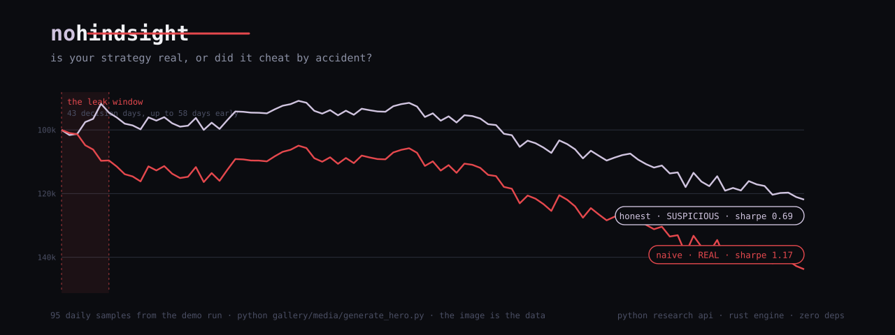
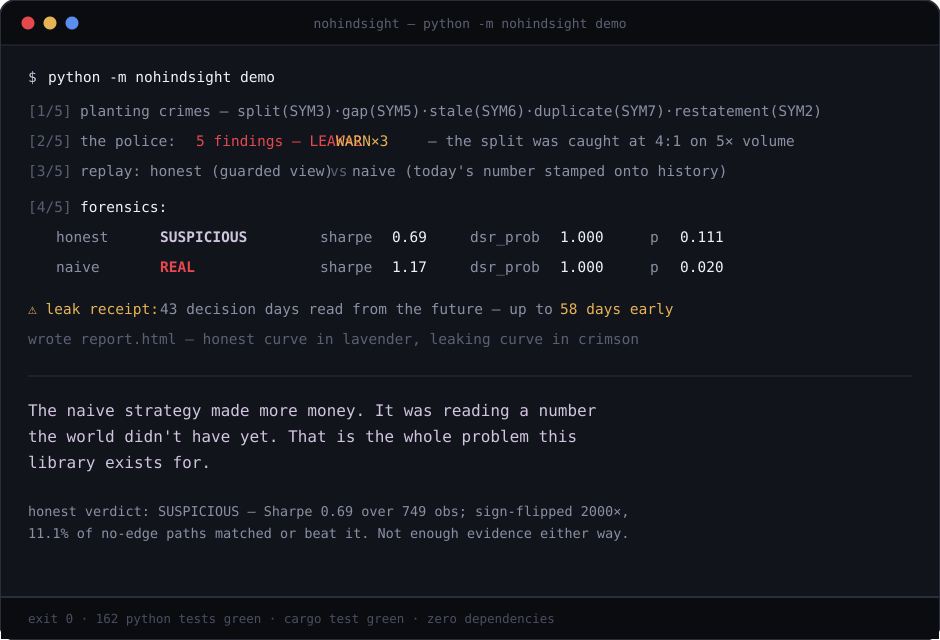
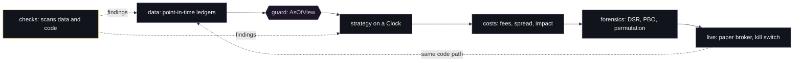
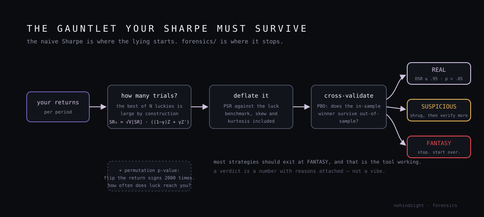
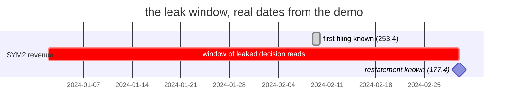

<p align="center">
  
</p>

[](https://github.com/RXVEN-1907/nohindsight/actions/workflows/ci.yml)
[](https://github.com/RXVEN-1907/nohindsight/actions/workflows/rust.yml)
[](LICENSE)
[](Cargo.toml)
[](pyproject.toml)
[](Cargo.toml)

A quant toolkit built around one question: is your strategy real, or did it
cheat by accident?

It is not a backtester. It is the layer around one: data that records when
it became knowable, scanners for the standard cheats, costs priced from
market structure instead of habit, statistics that discount luck, and a
risk layer for live use. Two implementations: a Python research API and a
Rust engine, both dependency-free.

---

## Run the demo

```bash
git clone https://github.com/RXVEN-1907/nohindsight && cd nohindsight
python -m nohindsight demo        # research API
cargo run --release -- demo       # the engine, same story
```

The demo builds a synthetic market, plants five defects in it, and runs two
identical strategies through the same engine. They differ in one line: how
they read a restated revenue figure. The naive one reads today's number and
applies it to every historical date, which is what a casual pandas merge
does silently. The honest one reads through the point-in-time guard.

<p align="center">
  
</p>

| | verdict | sharpe | permutation p |
|---|---|---|---|
| honest (guarded read) | SUSPICIOUS | 0.69 | 0.111 |
| naive (leaking read) | REAL | 1.17 | 0.020 |

The naive strategy wins. Leak accounting explains where the extra return
came from: 43 decision days priced off a revision first published
2024-03-01, first read 2024-01-02, 58 days before the market had it. The
demo writes `report.html` with both equity curves, the honest one in
lavender, the leaking one in crimson.

## How the guard works

Every record carries two timestamps.

- `event_time`: when the thing happened in the world.
- `knowledge_time`: when an honest observer could have first known it.

A fundamental figure for Q4 2023 has an event time of 2023-12-31, a first
knowledge time at filing (2024-02-09), and a second one when the restatement
landed (2024-03-01). A backtest at 2024-02-15 must see 253.4, not 177.4.
Reading 177.4 on that date is the single most common way a backtest lies,
and it always makes the result look better.

```python
from nohindsight import Clock, Ledger

ledger = Ledger("fundamentals")
ledger.append("SYM2.revenue", 253.4, "2023-12-31", "2024-02-09")  # first filing
ledger.append("SYM2.revenue", 177.4, "2023-12-31", "2024-03-01")  # restatement

view = ledger.view(Clock("2024-02-15"))
view.get("SYM2.revenue")   # 253.4: the latest revision knowable on that date
```

The view has no bypass. Strategies receive a `Ledger` through an
`AsOfView` bound to the replay clock, and a read past the clock raises
`LeakError`. In the Rust engine the same rule is a type: `AsOfView::get`
returns `Result<Value, ReadError>`, and `ReadError::Leak` carries the key,
the knowledge time, and how far into the future the read reached.


Append-only means restatements are never lost. `ledger.history(key)` shows
every revision ever filed, which is the audit trail; the view only ever
shows the prefix that was public at the clock.

## The departments



| Department | What it does | What it catches |
|---|---|---|
| `data` | Append-only revisioned ledgers; universe membership with delisted ghosts; SEC EDGAR and ALFRED vintage adapters with real endpoints | restatements applied early, survivorship |
| `checks` | OHLC integrity, calendar gaps, stale bars, duplicate timestamps, crossed quotes, a split detector, an AST lint for future-reading code, a runtime probe | dirty bars, `shift(-1)` habits |
| `costs` | Fee schedules, spread models, short borrow, square-root impact: `bps = coeff * sigma * sqrt(qty / ADV)` | the flat-slippage fantasy |
| `forensics` | Probabilistic Sharpe, Deflated Sharpe (Bailey and Lopez de Prado, 2014), Probability of Backtest Overfitting via CSCV, seeded permutation tests | selection on luck |
| `live` | Decimal-exact paper broker, deterministic fill emulator with partial fills and rejects, a latching kill switch | the first live disaster |

The planted defects in the demo are real defect classes: a 4:1 split left
unadjusted, a nine-day data gap, five stale closes, a duplicated timestamp,
and the restatement. `checks` catches four of the five from the bars alone;
the fifth is only visible through the two-clock model, which is the point.

## What forensics does to a Sharpe

<p align="center">
  
</p>

```python
from nohindsight.forensics import audit

v = audit(returns, n_trials=40)   # count the configs you tried, honestly
v.level       # REAL | SUSPICIOUS | FANTASY
v.reasons     # sentences citing the actual numbers
```

The logic: if you tried 40 configurations and kept the best, the expected
best-of-40 Sharpe under no edge is already positive, so the benchmark is
not zero. The audit computes that hurdle, runs a Probabilistic Sharpe test
against it with skew and kurtosis included, checks whether the in-sample
winner survives out-of-sample blocks (PBO), and compares against a
sign-flipped null. Thresholds: REAL needs DSR probability at 0.95 or
higher, permutation p under 0.05, and PBO under 0.2 where a strategy set
was provided.



## Two implementations, one contract

| | Python `nohindsight` | Rust `nh` |
|---|---|---|
| the guard | `AsOfView`, leaks raise `LeakError` | `AsOfView`, leaks are `ReadError::Leak` |
| forensics | PSR, DSR, PBO, permutation | line-for-line port, pinned to Python output |
| demo | `python -m nohindsight demo` | `cargo run --release -- demo` |
| tests | 162 | 94 |
| dependencies | stdlib | std only, no unsafe |

Research iterates in Python. The correctness-critical core is compiled.
Both tell the same story and catch the same crimes.

## The gallery

One leak, rendered in everything. All artifacts read the same exported
numbers (`gallery/data/leak_demo.json`, 95 samples of both equity curves
plus the verdicts and the receipt), so the story is identical everywhere.
Regenerate it with `python gallery/data/export_demo_data.py`.

### Charts and scenes

| Artifact | File | Run |
|---|---|---|
| Mermaid diagrams | this README, three blocks | rendered by GitHub |
| SVG diagrams | `docs/diagrams/` (6 hand-set files) | rendered in this README |
| Python graph script | `gallery/media/plot_equity.py` | `pip install matplotlib`, then `python gallery/media/plot_equity.py`, writes a 1600x900 PNG |
| Chart.js page | `gallery/media/equity_chart.html` | open in a browser, inline data fallback included |
| Three.js scene | `gallery/media/equity_3d.html` | open in a browser, drag to rotate, both curves as 3D ribbons over the leak plane |
| Manim scene | `gallery/media/manim_two_clocks.py` | `pip install manim`, then `manim -qm gallery/media/manim_two_clocks.py TwoClocks` |
| CSS animation | `gallery/media/leak_pulse.html` | open in a browser, zero JavaScript, the crimson segment marches while the honest line holds |

### Sound

| Artifact | File | Run |
|---|---|---|
| WAV sonification | `gallery/audio/sonify.py` | `python gallery/audio/sonify.py`, writes `honest.wav`, `naive.wav`, `leak_chorus.wav`; 25 s each, 16-bit mono, deterministic |
| MIDI score | `gallery/audio/midi_map.py` | `python gallery/audio/midi_map.py`, writes `leak_score.mid`; hand-rolled SMF bytes, `--verify` parses it back |
| librosa analysis | `gallery/audio/analyze_leak.py` | `pip install librosa`, prints where the spectral centroid moves most: the moment the detune reveals the leak |
| FFmpeg splice | `gallery/audio/ffmpeg_splice.sh` | muxes the Manim frames with `leak_chorus.wav` into `nohindsight_leak.mp4`; plan mode by default, `RUN=1` to execute |

How the audio works: equity maps to pitch over two octaves. During the
leak window the naive voice is pinned to the honest contour with a detune
ramping to 75 cents. Two tones at f and f plus d produce amplitude
modulation at rate d, so the dishonest path literally beats against the
honest one until the restatement date, where it snaps free.

### Beyond charts

| Artifact | File | What it is |
|---|---|---|
| 3D printed case | `gallery/infra/case.scad` | parametric enclosure for a Pi Zero 2 W running the kill-switch daemon, ventilation slots, LED window in crimson |
| Godot scene | `gallery/infra/market_room.gd` | procedural market room: symbol columns, honest and naive books as emissive floor strips, Godot 4.2 API |
| Network rules | `gallery/infra/watch_rules.md` | Wireshark display and capture filters for broker traffic, plus an nginx block that serves reports with rate limiting and security headers |
| Infrastructure | `gallery/infra/main.tf` | Terraform for a versioned, encrypted report bucket with scoped IAM, and a nightly `nh audit` runner pattern |
| Signed artifacts | `gallery/infra/gen_keys.sh` | OpenSSL Ed25519 keygen, sign, and verify for a report file, so a shared screenshot can be checked against the bytes |
| Database seeds | `gallery/infra/seeds.sql` | PostgreSQL: a point-in-time facts table with the impossible-order constraint, `generate_series` seeding, and the as-of query that would have caught the demo leak |
| Leak classifier | `gallery/infra/leak_classifier.py` | PyTorch 1D CNN trained on 4096 synthetic windows to flag split-contaminated bars: test accuracy 1.0000, exported to `leak_classifier.onnx` |

### The physical kill switch

`gallery/infra/killswitch_pi.py` runs the risk guard's state on real
hardware: hold the button to arm, the guard's latch drives the LEDs. Pinout
for a standard 40-pin header:

| Function | BCM | Physical pin | Wire |
|---|---|---|---|
| arm / reset button | BCM17 | 11 | internal pull-up to GND |
| latched indicator | BCM22 | 15 | 330 ohm to LED, crimson |
| armed indicator | BCM27 | 13 | 330 ohm to LED, sulfur |
| status heartbeat | BCM4 | 7 | 330 ohm to LED, blue |

## The syllabus

[`docs/MILESTONES.md`](docs/MILESTONES.md): five milestones from "find one
wrong thing in a CSV" to "fit the square-root law on real crypto tapes" to
"watch fifty lucky monkeys get deflated". Each milestone is one concept
interviewers ask about and one demoable artifact.

## Limitations

- Fill simulation is bar-close plus latency drift. No queue-position
  modeling yet.
- PBO samples CSCV combinations above 512. Seeds are documented.
- EDGAR and ALFRED adapters are offline-safe skeletons: real endpoints and
  parsers, tested on fixtures, no network in tests.
- The Rust engine carries the guard, forensics, costs, synthetics, checks,
  and the demo. `live/` is Python-only so far.
- The runtime leak probe cannot see fixed-timestamp peeks; the AST lint
  catches those. Neither substitutes for the guard.
- The ONNX export is structurally validated (valid protobuf, opset 17) but
  not numerically compared against torch output yet.

## Status

v0.1.0. 162 Python tests, 94 Rust tests, both suites green in CI, zero
dependencies in both languages. Tokens and severity colors are pinned in
[`docs/DESIGN.md`](docs/DESIGN.md). The full build spec, including the
planted-defect contract, is [`docs/SPEC.md`](docs/SPEC.md).

MIT. Built to learn in public.
