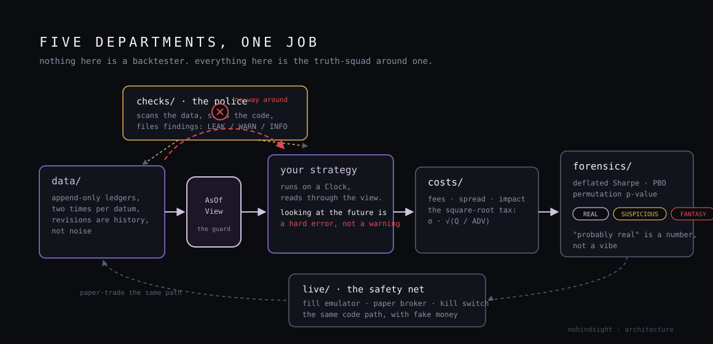
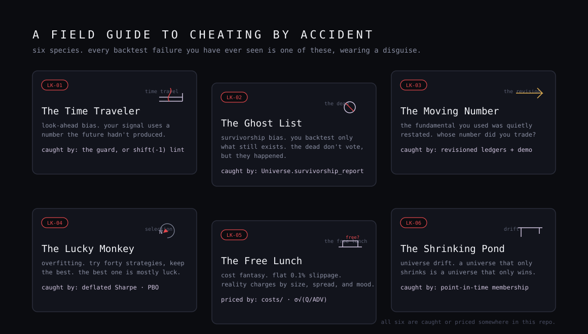

# nohindsight

**A quant toolkit that answers one question: is your strategy real, or did you cheat by accident?**

Not another backtester — there are plenty, and they all flatter you. This is
everything *around* the backtester: the data can't lie about when it was
known, the police catch dirty bars and time-traveling code, costs are priced
by physics instead of habit, the statistics interrogate your luck, and a
kill switch stands between your strategy and the world.

Pure Python standard library. Zero dependencies. Python 3.10+.

---

<p align="center">
  
</p>

Every datum carries two times. `event_time` is when it happened in the
world. `knowledge_time` is when an honest observer could have first known
it. A backtest that reads past the second clock has leaked — it used
information the future hadn't produced yet. In `nohindsight`, that is a hard
error, not a warning:

```python
from nohindsight import Clock, Ledger, LeakError

ledger = Ledger("fundamentals")
ledger.append("SYM2.revenue", 253.4, "2023-12-31", "2024-02-09")   # as first filed
ledger.append("SYM2.revenue", 177.4, "2023-12-31", "2024-03-01")   # restated, 30% down

view = ledger.view(Clock("2024-02-15"))
view.get("SYM2.revenue")        # 253.4 — the number the world had that day
view.get("anything.else")       # AsOfKeyError if nothing was knowable yet: not None, not zero, not forward-filled
```

Try to read the terminal number on February 15 and the ledger refuses —
there is no way around the guard, because the view *is* the only way in.

---

## Try it in one command

```bash
git clone https://github.com/RXVEN-1907/nohindsight && cd nohindsight
python -m nohindsight demo
```

The demo plants five crimes in synthetic data, then tells this story: two
identical strategies run through the same engine, same broker, same fees —
the **only** difference is that one reads revenue through the guard and one
does what every beginner's pandas merge does silently (today's number,
stamped onto every historical date). The naive one posts the better Sharpe.
Then the leak accountant shows you the receipt:

```
honest   SUSPICIOUS  sharpe   0.69   dsr_prob 1.000   p 0.111
naive    REAL        sharpe   1.17   dsr_prob 1.000   p 0.020

Leak accounting: naive read SYM2.revenue on 43 decision days from the
terminal snapshot — a revision first published 2024-03-01, used up to
58 days before the world had it.
```

The naive strategy made more money. It was reading a number the world
didn't have yet. That is the whole problem this library exists for.
It also writes `report.html` — dark, lavender for the honest curve,
crimson for the leaking one.

## The five departments

<p align="center">
  
</p>

| Department | What it does | The crime it stops |
|---|---|---|
| `nohindsight/data` | Append-only, revisioned, point-in-time ledgers; universe membership with ghosts; SEC EDGAR and ALFRED vintage adapters with real endpoints | The Moving Number, The Ghost List |
| `nohindsight/checks` | Bar-level police (OHLC, gaps, staleness, duplicates, crossed quotes), a split detector, an AST lint for future-reading code, and a runtime leak probe | dirty data, The Time Traveler |
| `nohindsight/costs` | Fees, spread, borrow, and market impact by the square-root law: `impact = σ · √(Q/ADV)` | The Free Lunch |
| `nohindsight/forensics` | Probabilistic and Deflated Sharpe (Bailey & López de Prado 2014), Probability of Backtest Overfitting via CSCV, seeded permutation tests — every verdict with reasons attached | The Lucky Monkey |
| `nohindsight/live` | Decimal-exact paper broker, a deterministic fill emulator (partials, rejects, latency), and a latching kill switch | The first live disaster |

<p align="center">
  
</p>

## The gauntlet

<p align="center">
  
</p>

```python
from nohindsight.forensics import audit

v = audit(returns, n_trials=40)   # be honest about how many configs you tried
print(v.level)                    # REAL | SUSPICIOUS | FANTASY
for reason in v.reasons:
    print("-", reason)            # plain-language sentences citing the numbers
```

A verdict is a number with reasons attached — not a vibe.

## Learn it by building it

[`docs/MILESTONES.md`](docs/MILESTONES.md) is the syllabus: five milestones,
each one README-worth of quant education and one demoable artifact — from
"find one wrong thing in a CSV of prices" to "fit the square-root law on
real crypto tapes" to "watch 50 lucky monkeys get deflated."

## Honest limitations (a library about honesty starts with itself)

- Simplified market simulation: fills at bar close plus latency drift; no
  queue-position modeling yet.
- PBO uses sampled CSCV combinations above 512; seeds are documented.
- EDGAR/ALFRED adapters are offline-safe skeletons — real endpoints, real
  parsers, tested on fixtures; bring your own network and honor the SEC
  user-agent rule.
- The runtime leak probe can't see fixed-timestamp peeks; the AST lint
  catches those, and neither is a substitute for the guard itself.

## Status

v0.1.0. **162 tests, all green, stdlib only.** See
[`docs/DESIGN.md`](docs/DESIGN.md) for the design language (lavender is the
truth, crimson is the leak — never decoration) and
[`docs/SPEC.md`](docs/SPEC.md) for the full build spec.

MIT. Built to learn in public.
